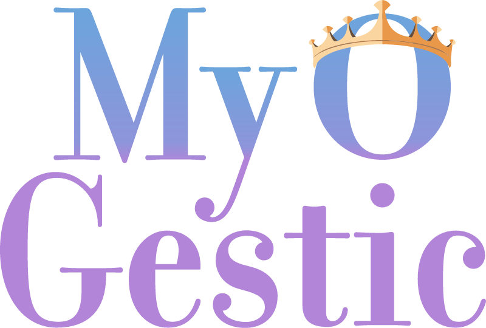
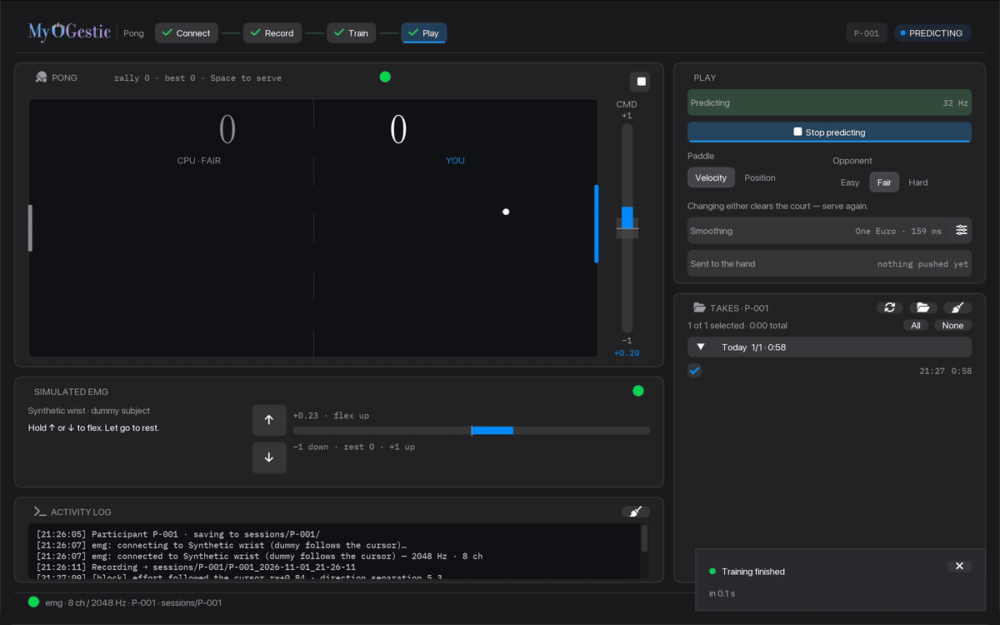
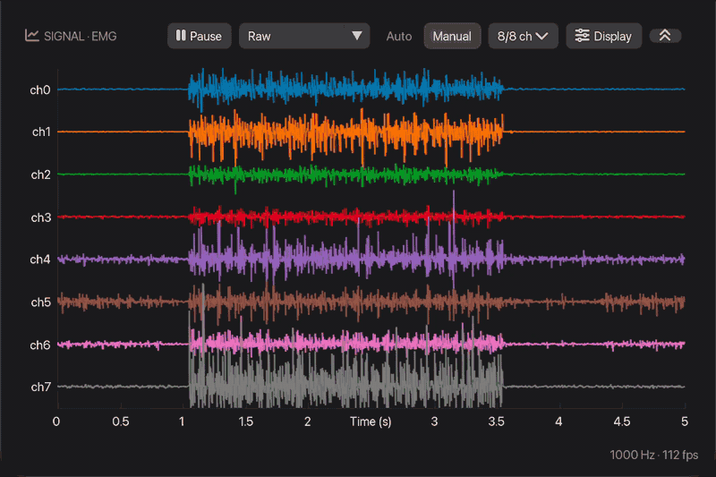
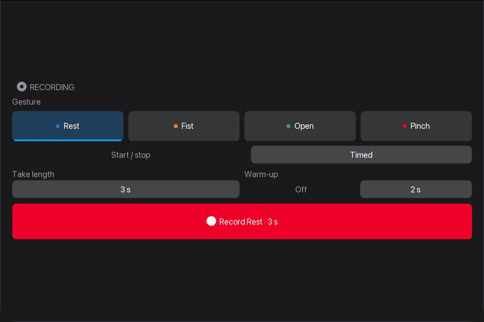
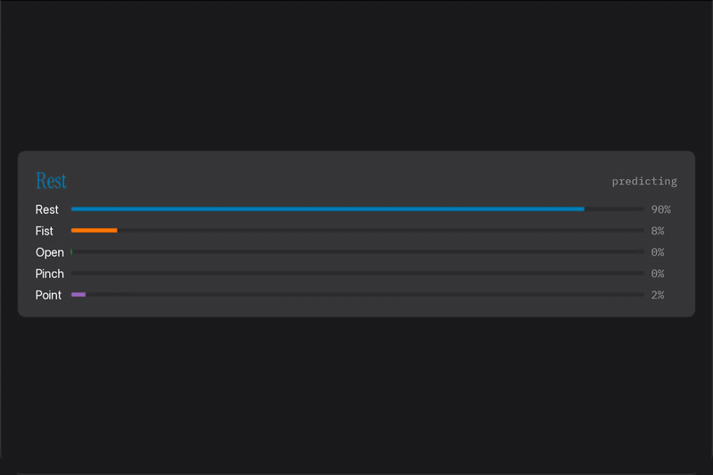
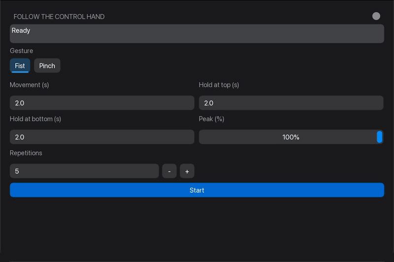
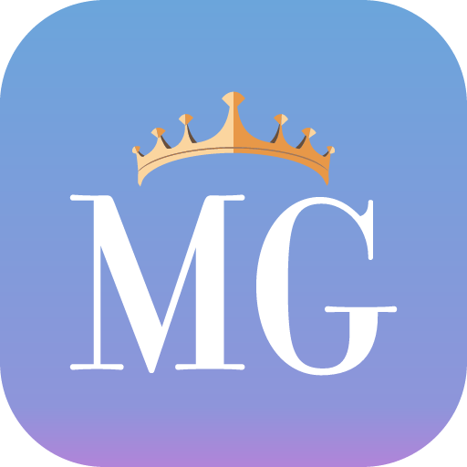

<p align="center">
  
</p>

<h3 align="center">Real-time biosignal experiment GUI builder</h3>

<p align="center">
  <a href="https://pypi.org/project/myogestic/"></a>
  <a href="https://pypi.org/project/myogestic/"></a>
  <a href="https://github.com/NsquaredLab/MyoGestic/actions/workflows/tests.yml"></a>
  <a href="https://nsquaredlab.github.io/MyoGestic/"></a>
  <a href="https://www.gnu.org/licenses/gpl-3.0"></a>
  <a href="https://doi.org/10.1126/sciadv.ads9150"></a>
</p>

<p align="center">
  <a href="https://nsquaredlab.github.io/MyoGestic/"><b>Documentation</b></a> ·
  <a href="https://nsquaredlab.github.io/MyoGestic/playground/"><b>Playground</b></a> ·
  <a href="https://www.science.org/doi/abs/10.1126/sciadv.ads9150"><b>Paper</b></a> ·
  <a href="https://github.com/NsquaredLab/MyoGestic-VHI"><b>Virtual Hand</b></a> ·
  <a href="https://github.com/NsquaredLab/MyoGestic/blob/main/CHANGELOG.md"><b>Changelog</b></a>
</p>

<p align="center">
  
</p>

MyoGestic turns a short Python script into a live experiment with signal
viewers, recording, training and prediction.

MyoGestic is built at the [n-squared lab](https://www.nsquared.tf.fau.de/) at
Friedrich-Alexander-Universität Erlangen-Nürnberg (FAU) for myocontrol research.
Version 2 supports small, composable APIs and live extensibility.
[MyoGestic v1](https://github.com/NsquaredLab/MyoGestic/tree/v1) is also available.

## Try it in your browser

A live MyoGestic app runs entirely in your browser via Pyodide at
[nsquaredlab.github.io/MyoGestic/playground](https://nsquaredlab.github.io/MyoGestic/playground/).
It streams synthetic electromyography (EMG), records in memory, trains a
scikit-learn linear discriminant classifier and predicts live.

## Install

```bash
pip install myogestic
```

Extras add optional parts. `examples` adds CatBoost, MyoVerse, PyTorch and
scikit-learn for the demos; `grpc` adds the Virtual Hand control plane. Other
extras are `brainflow`, `bdi`, `serial`, `keyboard`, `zarrs`, `docs` and `dev`.
Install one with `pip install "myogestic[grpc]"`.

To run the examples, clone the repository and sync it with uv:

```bash
git clone https://github.com/NsquaredLab/MyoGestic.git
cd MyoGestic
uv sync --extra examples --extra grpc
```

## Quick start

```python
from myogestic import App, Stream
from myogestic.sources import LSLSource
from myogestic.widgets import RecordingControls, SignalViewer

app = App("Hello EMG")
app.streams(Stream("emg", source=LSLSource("EMG"), window_ms=1000))

viewer = SignalViewer("emg")
recording = RecordingControls(
    ["Rest", "Fist"], on_record=app.start_recording, on_stop=app.stop_recording
)


@app.ui
def ui(ctx):
    viewer.ui(ctx)
    recording.ui(ctx)


app.run()
```

Add a `Pipeline` and decorate `extract` / `train` / `predict` for a closed-loop
experiment.

## Run a session

[`examples/start_here/`](https://github.com/NsquaredLab/MyoGestic/tree/main/examples/start_here)
holds complete protocols you can take to a session unmodified. Each picks its
hardware from a dropdown, so the same file runs against any supported amplifier
or the synthetic amplifier.

| Script | Protocol |
| --- | --- |
| `force_ramps.py` | Isometric force ramps. Track a trapezoid at a set percentage of maximum voluntary contraction, with the EMG, the force and the target recorded together. |
| `myocontrol.py` | Record cued Rest/Fist trials, train a classifier or a regressor, and drive the Virtual Hand from the prediction. |
| `pong.py` | Chase a cursor with the paddle, train one signed [−1, +1] command, and play Pong with your wrist. |

```bash
uv run --extra examples --extra grpc python examples/start_here/myocontrol.py
```

[WINDOWS.md](https://github.com/NsquaredLab/MyoGestic/blob/main/examples/start_here/WINDOWS.md)
walks from an empty Windows machine to a recorded force-ramps session, with no
programming assumed.

## Widgets

Each widget is one public function or class with typed arguments, placed on a
`Px`/`Fr` grid. Every card can pop out into its own window.

<table>
  <tr>
    <td align="center" width="50%">
      <br>
      <code>signal_viewer</code><br>Recorded EMG, eight channels on one shared range.
    </td>
    <td align="center" width="50%">
      <br>
      <code>recording_controls</code><br>Pick a gesture and record a timed take.
    </td>
  </tr>
  <tr>
    <td align="center" width="50%">
      <br>
      <code>prediction_label</code><br>The live prediction and each class's probability.
    </td>
    <td align="center" width="50%">
      <br>
      <code>FollowRun</code><br>Repetitions that follow the control hand.
    </td>
  </tr>
</table>

See every widget in the [widget gallery](https://nsquaredlab.github.io/MyoGestic/widget-gallery/).

## What MyoGestic provides

MyoGestic provides live Lab Streaming Layer (LSL) ingest, on-disk recording
from Zarr to `.mg.zip`, a machine-learning pipeline with training
and prediction on their own threads, Dear ImGui widgets, output filters, and
gRPC plus LSL integration with the
[Virtual Hand Interface](https://github.com/NsquaredLab/MyoGestic-VHI).

Write signal processing, features and models with scipy, MyoVerse, CatBoost
or PyTorch.

## More examples

[`examples/synthetic/`](https://github.com/NsquaredLab/MyoGestic/tree/main/examples/synthetic)
holds runnable demos and templates to copy.

| Script | Shows |
| --- | --- |
| `my_session_app.py` | A session app to copy. Change the classes, features, training and prediction. |
| `emg_classification.py` | Binary CatBoost classification with an optional Virtual Hand. |
| `emg_regression.py` | Continuous regression of five degrees of freedom. |
| `emg_regression_raulnet.py` | The same flow with a PyTorch Lightning convolutional network. |
| `emg_32ch_multi_model.py` | A selectable classifier with Save and Load. |
| `electrode_grids.py` | A 256-channel stream split into four tiled viewers with a shared range. |

## Documentation

| Page | Covers |
| --- | --- |
| [Getting started](https://github.com/NsquaredLab/MyoGestic/blob/main/docs/getting-started.md) | Install, run a protocol and write your own app. |
| [Tutorials](https://github.com/NsquaredLab/MyoGestic/tree/main/docs/tutorials) | EMG classification, and EMG regression with the Virtual Hand. |
| [How-to guides](https://github.com/NsquaredLab/MyoGestic/tree/main/docs/how-to) | A custom source, widget or model, the Virtual Hand, and the recipe feature set. |
| [Concepts](https://github.com/NsquaredLab/MyoGestic/tree/main/docs/concepts) | Architecture, streams, pipeline, threading, recording, the `Px`/`Fr` grid and the `EdgeTrigger` pattern. |
| [API reference](https://github.com/NsquaredLab/MyoGestic/tree/main/docs/api) | Generated from the docstrings. |
| [API cheatsheet](https://github.com/NsquaredLab/MyoGestic/blob/main/docs/reference/api-cheatsheet.md) | The most-used public symbols on one page. |

## Development

```bash
uv sync --extra dev
uv run pytest -q
uv run ruff check .
```

Some integration tests need a live LSL outlet. To build and serve the docs
locally:

```bash
uv sync --extra docs
cd website
npm ci
npm run dev
```

Use Node.js 22 (see `website/.nvmrc`), then open
`http://localhost:4321/MyoGestic/`. Run `npm run build` from `website/`
to build the site.

## How to cite

If you use MyoGestic in your research, please cite our
[Science Advances paper](https://www.science.org/doi/abs/10.1126/sciadv.ads9150):

Sîmpetru, R. C. et al. MyoGestic: EMG interfacing framework for decoding
multiple spared motor dimensions in individuals with neural lesions.
*Science Advances* 11, eads9150 (2025).

<details>
<summary>BibTeX</summary>

```bibtex
@article{Simpetru2025,
    author  = {Raul C. S{\^i}mpetru and Dominik I. Braun and Arndt U. Simon
               and Michael M{\"a}rz and Vlad Cnejevici
               and Daniela Souza de Oliveira and Nico Weber and Jonas Walter
               and J{\"o}rg Franke and Daniel H{\"o}glinger and Cosima Prahm
               and Matthias Ponfick and Alessandro Del Vecchio},
    title   = {MyoGestic: EMG interfacing framework for decoding multiple
               spared motor dimensions in individuals with neural lesions},
    journal = {Science Advances},
    volume  = {11},
    number  = {15},
    pages   = {eads9150},
    year    = {2025},
    doi     = {10.1126/sciadv.ads9150},
    url     = {https://www.science.org/doi/abs/10.1126/sciadv.ads9150},
}
```

</details>

<a id="license"></a>

## Licence

MyoGestic is licensed under the
[GNU General Public License v3.0](https://www.gnu.org/licenses/gpl-3.0.html)
(GPL-3.0). Derivative work must remain open under the same licence.

<p align="center">
  <br>
  <sub>n-squared lab · Friedrich-Alexander-Universität Erlangen-Nürnberg</sub>
</p>
