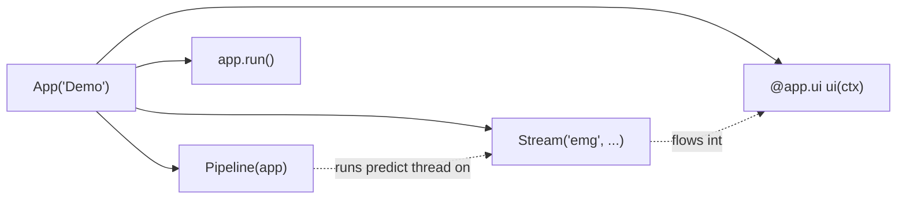

Read the script alongside the descriptions below. The concept pages cover individual components in detail.

```python
from myogestic import App, Stream, TrainingData
from myogestic.ml import Pipeline, save_pickle, load_pickle
from myogestic.ml.widgets import PipelinePanel
from myogestic.session import iter_labeled_windows
from myogestic.sources import LSLSource
from myogestic.widgets import RecordingControls, SessionManager, SignalViewer
from sklearn.linear_model import LogisticRegression
import numpy as np

app = App("EMG Demo")
app.streams(Stream("emg", source=LSLSource("EMG"), window_ms=200))

pipeline = Pipeline(app, predict_hz=20)
pipeline.save_model = save_pickle
pipeline.load_model = load_pickle


@pipeline.extract
def extract(windows):
    return windows["emg"].mean(axis=1)


@pipeline.train
def train(data: TrainingData):
    X, y = [], []
    for window, _ts, c in iter_labeled_windows(data.paths, "emg", 200, 100, classes=data.classes):
        X.append(extract({"emg": window}))
        y.append(c)
    return LogisticRegression().fit(np.array(X), np.array(y))


@pipeline.predict
def predict(model, features):
    return {"class": int(model.predict(features.reshape(1, -1))[0])}


emg_viewer = SignalViewer("emg")
rec_controls = RecordingControls(
    ["Rest", "Fist"], on_record=app.start_recording, on_stop=app.stop_recording
)
sessions = SessionManager("data", class_names=["Rest", "Fist"])
ml_panel = PipelinePanel(pipeline)


@app.ui
def ui(ctx):
    emg_viewer.ui(ctx)
    rec_controls.ui(ctx)
    pipeline.training_data = sessions.ui()
    ml_panel.ui()


app.run()
```

## The shape

A MyoGestic app has one [`App`][myogestic.App] object, [streams][myogestic.Stream], an optional [`Pipeline`][myogestic.ml.Pipeline] for ML, and a `@app.ui` callback that draws widgets every frame. `app.run()` starts threads and blocks on the GUI loop.



## Imports, in three layers

```python
from myogestic import App, Stream, TrainingData  # the orchestrator + data primitives
from myogestic.ml import Pipeline, save_pickle, load_pickle  # ML lifecycle layer (opt-in)
from myogestic.session import iter_labeled_windows  # session reading helpers
from myogestic.sources import LSLSource  # one of the built-in sources
from myogestic.widgets import (
    RecordingControls,
    SessionManager,
    SignalViewer,
)  # ImGui widget classes
from sklearn.linear_model import LogisticRegression  # YOUR ML library
```

Three layers, from framework-owned to user-owned:

1. Compose framework primitives from `App`, `Stream`, `Pipeline` and `TrainingData`.
2. Add built-in capabilities from `sources`, `widgets`, `ml` and `session`.
3. Write domain code with sklearn, MyoVerse, scipy or PyTorch.

DSP, ML models and feature extraction are user concerns. `myogestic.recipes` supplies optional feature functions and estimator constructors as starting points. See [Design principles](concepts/design-principles.md).

## `App` - the orchestrator

```python
app = App("EMG Demo")
```

One per process. [`App`][myogestic.App] owns the GUI loop, the shared [`Context`][myogestic.Context], the run-loop lifecycle hooks, and the recording state machine. Construct it, attach streams and widgets with an optional pipeline, then call `app.run()`.

Compose an `App` by attaching objects.

→ Deep dive: [Architecture](concepts/architecture.md), [Design principles](concepts/design-principles.md).

## `Stream` - the data plumbing

```python
app.streams(Stream("emg", source=LSLSource("EMG"), window_ms=200))
```

A [`Stream`][myogestic.Stream] wraps a [`Source`](concepts/streams.md) plus a fixed-memory ring buffer. Each stream owns one daemon acquisition thread that polls the source, appends to the buffer, and writes to a Zarr array while `app.start_recording()` is active. Plotting and prediction copy only their requested recent tail, so acquisition work does not grow as the history fills.

Two reads come out the other side:

- `stream.get_window()` returns `(data, timestamps)`, with the most recent `window_ms` of data channels-first `(n_channels, n_samples)`. This is what feature extractors and ML models consume.
- `stream.get_raw_snapshot_stable(duration_s)` returns a stable recent tail for rendering. [`SignalViewer`][myogestic.widgets.SignalViewer] requests only its visible duration and decimates it to the live plot width.

[`app.streams(*streams)`][myogestic.App.streams] registers one or more. Each registered `Stream` wraps any `Source` implementation, so swapping [`LSLSource`][myogestic.sources.LSLSource] for offline replay with [`ReplaySource`][myogestic.sources.ReplaySource] or your own custom source changes one line.

The stream starts detached. Start the upstream outlet and press Connect in the viewer, or call `stream.reconnect()` before headless acquisition.

→ Deep dive: [Streams](concepts/streams.md).

## `Pipeline` - the optional ML lifecycle

```python
pipeline = Pipeline(app, predict_hz=20)
pipeline.save_model = save_pickle
pipeline.load_model = load_pickle
```

[`Pipeline(app)`][myogestic.ml.Pipeline] adds:

- A predict thread that fires every `1/predict_hz` seconds.
- Two states, `training` and `predicting`. A take may also stay open while predicting, tracked separately by `ctx.recording`.
- Three function-decorator slots (`extract`, `train`, `predict`) for your code.

Attach a `Pipeline` for ML. Recording and visualization work without it.

`save_model` / `load_model` are plain attribute slots. They enable the separate `SaveModelButton` / `LoadModelButton` widgets when those are added to the UI. `PipelinePanel` itself contains Train and Predict controls. The default [`save_pickle`][myogestic.ml.save_pickle] / [`load_pickle`][myogestic.ml.load_pickle] round-trip anything pickleable.

→ Deep dive: [Pipeline](concepts/pipeline.md).

## `@pipeline.extract` - feature extraction

```python
@pipeline.extract
def extract(windows):
    return windows["emg"].mean(axis=1)
```

Receives a dict keyed by stream name. Each value is channels-first `(n_channels, n_samples)`. Return the input your model needs, such as a feature vector, tuple or raw window. It becomes the `features` argument to `predict()`.

The same function runs from inside `train()` over recorded windows, and on the predict thread over live windows.

## `@pipeline.train` - training

```python
@pipeline.train
def train(data: TrainingData):
    X, y = [], []
    for window, _ts, c in iter_labeled_windows(data.paths, "emg", 200, 100, classes=data.classes):
        X.append(extract({"emg": window}))
        y.append(c)
    return LogisticRegression().fit(np.array(X), np.array(y))
```

Runs on a one-shot training thread when the user clicks Train. Receives [`TrainingData`][myogestic.TrainingData] with `paths`, `class_names` and `classes` populated by [`SessionManager`][myogestic.widgets.SessionManager]. Return an object to store on `pipeline.model`.

[`iter_labeled_windows`][myogestic.session.iter_labeled_windows] opens session folders or `.mg.zip` archives, reads the label track, and slices trials into overlapping windows. Write your feature extraction for these windows.

→ Deep dive: [Pipeline](concepts/pipeline.md), [Recording](concepts/recording.md).

## `@pipeline.predict` - live prediction

```python
@pipeline.predict
def predict(model, features):
    return {"class": int(model.predict(features.reshape(1, -1))[0])}
```

Fires at `predict_hz` while the user is in Predict mode and at least one input stream has data. Return a `dict[str, Any]`; the result is stored in `pipeline.predictions` for widgets to read.

Publish to an outlet or push a `ControlBus` from `predict()` before returning. A paced outlet sends its latest value at its own rate; a target may instead deliver commands directly.

## `@app.ui` - the rendering surface

```python
emg_viewer = SignalViewer("emg")
rec_controls = RecordingControls(
    ["Rest", "Fist"], on_record=app.start_recording, on_stop=app.stop_recording
)
sessions = SessionManager("data", class_names=["Rest", "Fist"])
ml_panel = PipelinePanel(pipeline)


@app.ui
def ui(ctx):
    emg_viewer.ui(ctx)
    rec_controls.ui(ctx)
    pipeline.training_data = sessions.ui()
    ml_panel.ui()
```

The `@app.ui` callback runs on the main thread every frame. Call each widget's `.ui()` method to draw ImGui commands from its live inputs. Its instance or identity-keyed state persists between frames.

Widget roles include

1. Display widgets such as [`SignalViewer`][myogestic.widgets.SignalViewer] render `ctx.streams` data.
2. Control widgets such as [`RecordingControls`][myogestic.widgets.RecordingControls] and [`PipelinePanel`][myogestic.ml.widgets.PipelinePanel] call recording, training and prediction callbacks.
3. Bridge widgets such as [`SessionManager`][myogestic.widgets.SessionManager] return `TrainingData` for `pipeline.training_data`, passing UI selection to training.

For grid layouts use [`Grid`][myogestic.Grid] and `with grid[r, c]:`. For pop-out windows use `App(docking=True) + app.popout(...)`.

→ Deep dive: [Widgets](concepts/widgets.md).

## `app.run()` - the blocking event loop

```python
app.run()
```

Last line of every script. In order:

1. Starts each `Stream`'s acquisition thread.
2. Fires `before_run_hooks`, including `Pipeline`'s predict-thread startup.
3. Hands control to the blocking GUI event loop on the main thread.
4. On window close, runs `cleanup_hooks`, saves any open take inline, waits up to 30 seconds for pending saves, then stops streams, bridges and adopted subprocesses.

`app.run(mode="gui")` is the default. Use `mode="headless"` for unattended recording with threads only.

→ Deep dive: [Architecture](concepts/architecture.md), [Threading](concepts/threading.md).

## Driving a device

Drive a prosthesis on a serial port, a motor controller, a cursor or the Virtual Hand
through a [`Target`][myogestic.controls.Target]. It has three methods and a TOML control map
that pairs model outputs with controls.

`examples/synthetic/my_device.py` is a complete one with three lines left for you, and it runs
without hardware:

```bash
uv run python examples/synthetic/my_device.py
```

→ [Drive your own device](how-to/add-a-target.md). To publish predictions for another
program, push an [`LSLOutlet`][myogestic.outputs.LSLOutlet] from `predict()`. See
[Publish a data stream](how-to/add-an-output.md).

## Extending the skeleton

- Recording lifecycle. The controls above start and stop takes. Streams *flow* whether you record or not. Recording starts when [`app.start_recording()`][myogestic.App.start_recording] is called, typically by the [`RecordingControls`][myogestic.widgets.RecordingControls] widget's Record button. See [Recording](concepts/recording.md).
- Multi-stream. A second `Stream("imu", ...)` and your `extract()` sees `windows["imu"]` too. Match the [`iter_aligned_windows`][myogestic.session.iter_aligned_windows] pattern in `train()` for paired primary/target streams. See [Recording](concepts/recording.md).
- Bridges. Webcam and ultrasound sources run as subprocesses via [`app.bridges(...)`][myogestic.App.bridges]. See [Threading](concepts/threading.md).

## Where to read next

The concept pages describe each component in more detail:

- [Streams](concepts/streams.md) - ring buffer geometry, the channels-first contract, `get_display` decimation.
- [Pipeline](concepts/pipeline.md) - state machine, decorator semantics, stale-tick guards.
- [Recording](concepts/recording.md) - sessions, label tracks, the `.mg.zip` archive.
- [Widgets](concepts/widgets.md) - the construct-once `.ui()` pattern, `Grid` layout, pop-out windows.
- [Architecture](concepts/architecture.md) - thread roles and the data flow diagram.
- [Threading](concepts/threading.md) - GIL release, GPU contention rule, bridge subprocesses.
- [Design principles](concepts/design-principles.md) - the eight rules the framework keeps to.

Or jump straight into a hands-on walkthrough: the [EMG classification tutorial](tutorials/emg-classification.md) builds on this skeleton with real features, real data, and a real model.
