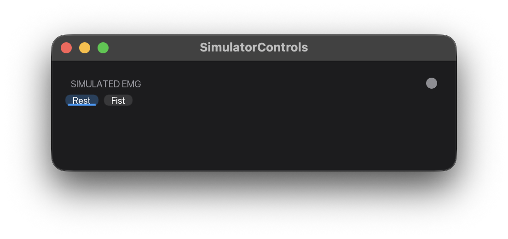
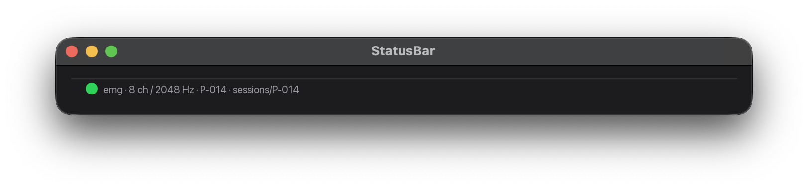
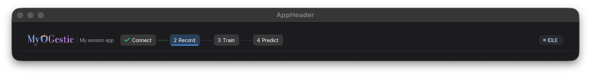

# Widgets

Widget classes you construct once and render with `.ui(...)` from inside `@app.ui`. See the [Widgets concept page](../concepts/widgets.md) for the contract and the [widget gallery](../widget-gallery.md) for a visual index of all of them on one page.

## Signal viewers

::: myogestic.widgets.SignalViewer

{ loading=lazy }

::: myogestic.widgets.RawSignalViewer

## Simulator controls

::: myogestic.widgets.SimulatorControls

{ loading=lazy }

Place `SimulatorControls([("Rest", 0.0), ("Fist", 1.0)])` in a compact Grid row
under the signal and call `simulator.ui(ctx)` on every step. Preset chips publish
the selected class value to the generator. The default control outlet is created
on the first `ui` or `set` call; pass `outlet=` to reuse an existing stream.

Call `simulator.set(value)` from the recording gesture callback to keep the card
and signal in sync. During recording the manual controls are disabled, with a
visible explanation that the simulator follows the recorded gesture.

## Device selection

::: myogestic.widgets.DevicePicker

### Describing a device

`DEFAULT_DEVICES` covers the shipped amplifiers. Build a `DeviceSpec` only for hardware the picker does not already list.

::: myogestic.widgets.DeviceSpec

::: myogestic.widgets.DeviceOption

::: myogestic.widgets.DeviceParam

::: myogestic.widgets.signals.device_picker.DEFAULT_DEVICES

::: myogestic.widgets.signals.device_picker.OTB_DEVICES

::: myogestic.widgets.signals.device_picker.LSL_DEVICE

::: myogestic.widgets.signals.device_picker.SYNTHETIC_DEVICE

## Recording and sessions

::: myogestic.widgets.ParticipantPanel

The header chip opens **Recorded** when readable takes exist under `sessions_dir`
(default `"sessions"`), otherwise **New participant**. Recorded participants are listed
by latest recording, with gesture dots (or `cursor`), take counts, duration and saved
model availability. Search uses IDs; **Show names** also enables local name search.
Names start masked and are hidden again when the dialog closes. **Continue with ID**
selects an existing participant without changing the key file.

**New participant** offers the next free ID, optional first and family names, and a
preview of the labelled recording and model paths. Returning names match without
regard to case or accents. **Start session** selects the ID; recording still starts
through the recording controls. The chip is disabled during recording, training and
prediction, and an open dialog closes when the app becomes busy.

Pass `on_drive=callback` to offer **Drive with saved model** for participants with a
saved `*_model.joblib`. The callback receives `(participant_id, model_path)` after
`ctx.participant` has been set; `model_path` is a `Path` to the most recently modified
model in that participant's folder. Takes are scanned once each time the dialog
opens, using the same pending-save exclusions as `SessionManager`.

Names stay in widget memory and the local `~/myogestic/participant-key.csv` key file;
only the safe ID reaches `ctx.participant` and saved data. Keep a custom `key_file`
outside the sessions directory. See the standalone
[`participant_panel.py` example](https://github.com/NsquaredLab/MyoGestic/blob/main/examples/panels/participant_panel.py).

::: myogestic.widgets.RecordingControls

{ loading=lazy }

::: myogestic.widgets.RecordButton

::: myogestic.widgets.StreamManager

::: myogestic.widgets.SessionManager

{ loading=lazy }

## Force tracking

See [Track a force target](../how-to/track-a-force-target.md) for the whole loop, including how the transducer reaches the stream and why calibration takes two captures.

::: myogestic.widgets.TrackingTask

## Task trajectories

What a subject is asked to follow. `myogestic.tracking` is plain data — no ImGui, nothing that talks to a device — so the same trajectory can be evaluated in a test, in an offline script and by whatever draws it, with no second implementation to drift. `TrackingTask` forwards every edit to the [`TargetSource`][myogestic.sources.TargetSource] it was handed, so what is drawn and what is recorded cannot diverge.

`Trajectory` is the structural protocol these shapes satisfy by having its three members, not by inheriting anything. They differ in unit and in what they are for: `Trapezoid` is percent of MVC for [isometric force tracking](../how-to/track-a-force-target.md); `Pursuit` is signed `[-1, +1]` control units for [proportional-control training](../how-to/record-for-proportional-control.md), and it exists because a block cueing only Down / Rest / Up asks for three distinct target values, so what a fit produces between them comes from the estimator rather than from the recording — for the tree ensembles shipped here, nothing at all.

::: myogestic.tracking.Trajectory

::: myogestic.tracking.Trapezoid

::: myogestic.tracking.Pursuit

::: myogestic.tracking.Calibration

## Proportional-control game

::: myogestic.widgets.PongTask

The command is signed: `+1` is the top of the court, `-1` the bottom, and `-1` is a real value rather than the absence of `+1`. The widget is only the game — it reads no stream, no session and no model, so whatever produces the float (a decoder, a force channel, a slider) stays the app's business. [`examples/start_here/pong.py`](https://github.com/NsquaredLab/MyoGestic/blob/main/examples/start_here/pong.py) drives it from a [`directional_decoder`][myogestic.recipes.estimators.directional_decoder]; [`examples/panels/pong.py`](https://github.com/NsquaredLab/MyoGestic/blob/main/examples/panels/pong.py) drives it from a slider.

`control` decides what the command *does*, and neither mode is right in general. `"velocity"`, the default, integrates it, which turns even a three-output decoder into a complete controller — up / hold / down reach every height in the court — at the cost of accumulating the decoder's resting bias. The dead zone it carries slows that and does not stop it — a *constant* command inside the band integrates to nothing, but bias plus ordinary noise rectifies to something positive and walks the paddle onto a wall in tens of seconds while the subject holds still, so expect them to be correcting and press Serve to recentre. `"position"` maps the command onto the paddle's travel, the full range across the full travel: it cannot drift, and where the paddle sits is what the model just emitted scaled to the court, which makes it the honest mode to debug against and the better one once the command is genuinely continuous.

`ui(command, target=…)` draws a **ghost paddle** for that command — the reference a subject tracks while a training block records, typically [`Pursuit.value_at`][myogestic.tracking.Pursuit.value_at]. `target` is in the same signed `[-1, +1]` as `command`, not a court coordinate: it is mapped onto the paddle's travel by the same line `control="position"` uses, so a subject sitting on the ghost has produced exactly the number the session recorded. The ghost does not play the ball and is not a second player. Generating the trajectory and recording against it belong to the app, not the widget.

Without `opponent` the far wall simply returns the ball, and the score is hits against misses. Pass `opponent` and a second paddle plays it back, with each side's points drawn on its own half — the same rally, now with something to win. `opponent` sets that paddle's top tracking speed as a multiple of `ball_speed`, so slowing the ball also slows the CPU at every difficulty.

`paddle_size` sets the player's paddle height in court units: the court is 2.0 tall, so the default `0.36` covers 18% and `0.6` covers 30%. The keyword-only `opponent_paddle_size=None` uses the same height for both paddles, preserving existing games. Set it separately to give the player more reach without enlarging the CPU: `PongTask(ball_speed=0.35, paddle_size=0.6, opponent_paddle_size=0.36, opponent=0.6)`. Both sizes are clamped to `[0.02, 2.0]`. The CPU's drawing, tracking bounds and returns use its own height; the player's travel and pursuit ghost use the player's height.

The start-here example exposes `BALL_SPEED`, `PADDLE_SIZE` and `OPPONENT_PADDLE_SIZE` near its other tunables. Its ball crosses the court in about 2.9 s at `0.35` court widths per second, compared with about 1.8 s at the widget's default `0.55`.

`win_score=11` stops the ball on the winning point and sets the read-only `game_over` property. **Play again** resets the score, paddles, longest rally and clock; `win_score=None` keeps the game endless. `opponent_name="Fair"` labels the CPU, and an optional `on_harder` callback adds **Harder** to the game-over overlay so the app can rebuild at its next difficulty. These constructor arguments are keyword-only.

Serve is inside the court. **Space** also serves when the app window has focus and no text field is active. The **CMD** meter shows the signed command and shades the velocity dead band; when `target` is supplied, **EFFORT** instead shows the unsigned `effort` magnitude with a tick at `abs(target)`. The ghost and effort gauge do not infer the contraction's direction.

## Process management

::: myogestic.widgets.ProcessLauncher

{ loading=lazy }

## Plotting

::: myogestic.widgets.Scatter2D

::: myogestic.widgets.Scatter3D

::: myogestic.widgets.Heatmap

::: myogestic.widgets.LinePlot

## Output processing

::: myogestic.widgets.PostProcessor

{ loading=lazy }

::: myogestic.widgets.FilterProcessor
    options:
      summary:
        functions: true
        attributes: true

::: myogestic.widgets.FilterSpec

::: myogestic.widgets.FilterParam

## Feature selection

::: myogestic.widgets.FeatureSelector

{ loading=lazy }

## Training and inspection

::: myogestic.widgets.TemplateInspector

::: myogestic.widgets.training.template_inspector.TemplateInspectorRow

::: myogestic.widgets.TrialPreview

## Layout helpers

::: myogestic.widgets.panel_header

::: myogestic.widgets.popout_panel

## Status and logs

::: myogestic.widgets.StatusBar

{ loading=lazy }

Place `StatusBar("emg")` in a bare `Px(26)` Grid row and call `status.ui(ctx)`.
It shows the stream's connection and channel details, participant and session
folder, with the full text on hover. Pass `sessions_dir` for a custom storage
root and `pipeline` to add a right-aligned fitted or saved model readout.
Long details ellipsize; no caller style pushes are needed.

::: myogestic.widgets.StreamPanel

::: myogestic.widgets.LogPanel

## Branding

::: myogestic.widgets.AppHeader

{ loading=lazy }

Place `AppHeader` in a bare `Px(52)` Grid row. It draws the line logo, muted
title and state pill, with optional `StepBar` navigation and a `ParticipantPanel`
chip. Call `header.ui(ctx, done)` inside the cell; no style pushes are needed.
Without steps, `done` is optional and the return value is `None`. Long titles
ellipsize and reveal their full text on hover. With steps, the title yields
first, then step padding tightens; the participant chip yields to the state pill.
At smaller widths only the active step retains its label, and the others show
their number or checkmark with the full label on hover.

Grid caps vertical padding in short bare rows so a control fits inside the row.
See the standalone
[`app_header.py` example](https://github.com/NsquaredLab/MyoGestic/blob/main/examples/panels/app_header.py)
for headers with and without workflow steps.

::: myogestic.widgets.Image

::: myogestic.widgets.AppLogo

{ loading=lazy }

## ML readout

::: myogestic.widgets.PredictionLabel

{ loading=lazy }

## Virtual Hand integration

::: myogestic.widgets.vhi.panel.VhiMovementPanel

{ loading=lazy }

### Lower-level pieces

`VhiMovementPanel` wraps these for the common case. Reach for them directly when you want to share one state cache across multiple panels, or render the palette without owning a client.

::: myogestic.widgets.vhi.palette.vhi_movement_palette

::: myogestic.widgets.vhi.palette.VhiStateCache

::: myogestic.widgets.vhi.palette.VhiStateSnapshot

::: myogestic.widgets.vhi.palette.request_vhi_state_refresh

## Follow the control hand

::: myogestic.widgets.FollowRun

::: myogestic.tracking.Sinusoid

::: myogestic.tracking.blend_pose

::: myogestic.tracking.score_tracking

`FollowRun` owns a dedicated recorded take. Gesture chips address the supplied names;
`tick(ctx)` returns `(gesture_index, level)` on each control update, or `None` when idle.
`level` is a fraction in `[0, peak]`. `Sinusoid` holds relaxed, moves up with a half-cosine,
holds at the peak, and moves down with a half-cosine, repeating after an optional lead-in.
The shape uses the existing `PHASE_CODES` without changing the recorded vocabulary.

Construct the card once, call `sync` on every GUI frame (including hidden tabs), and call
`tick` immediately before delivering each control frame. The widget records those targets
as `follow.target` with `gesture_index`, `level`, and `phase` channels, on the LSL clock.
Use the app's relaxed and gesture poses with `blend_pose`. A complete hardware-free demo
is [`examples/panels/follow_run.py`](https://github.com/NsquaredLab/MyoGestic/blob/main/examples/panels/follow_run.py).

<!--docs:run-->
```python
from myogestic import App
from myogestic.tracking import Sinusoid, blend_pose
from myogestic.widgets import FollowRun

app = App("Follow example")
follow = FollowRun(
    ["Fist", "Pinch"],
    on_record=app.start_recording,
    on_stop=app.stop_recording,
    trajectory=Sinusoid(move_s=2.0, hold_high_s=1.0, hold_low_s=1.0, reps=5),
)
relaxed = [0.0, 0.0]
poses = [[1.0, 1.0], [1.0, 0.0]]

def control_tick(ctx):
    target = follow.tick(ctx)
    if target is not None:
        index, level = target
        return blend_pose(relaxed, poses[index], level)
    return None

# In the GUI callback: follow.sync(ctx), then follow.ui(ctx) inside its Grid cell.
# Before shutdown, close the take while the recording callback is still available.
app.cleanup_hooks.append(lambda _app: follow.stop(app.ctx))
assert control_tick(app.ctx) is None
```

The default score compares `follow.target.level` to the saved `controls` stream's
`prediction` channel, so it measures delivered predictions. Both must use the same
fractional units. For a pose-vector app, project the delivered prediction onto its chosen
gesture, record that scalar using `Session.append_event`, and pass its stream name and
channel to `FollowRun(prediction_stream=..., prediction_channel=...)`. No device, model,
or VHI connection is required by the widget itself. Myocontrol wraps the recording
callbacks to start and stop prediction using the existing Drive gates.

Stopping early scores only the recorded part after the lead-in. The saved take carries
`extras.follow`, is labelled **Follow** in Takes, and remains unticked for training by
default. Saving finishes before the widget reopens the take to score it. RMSE and Pearson r
are measured without a lag correction; lag maximises normalised cross-correlation within
`max_lag_s` (default ±1 second), at 10 ms resolution. Positive lag means prediction trails
the control target. No overlapping samples gives undefined metrics; a constant signal has
an RMSE but no correlation or lag, displayed as a dash. A periodic run can have repeated
correlation peaks, so choose a search window shorter than a cycle.
