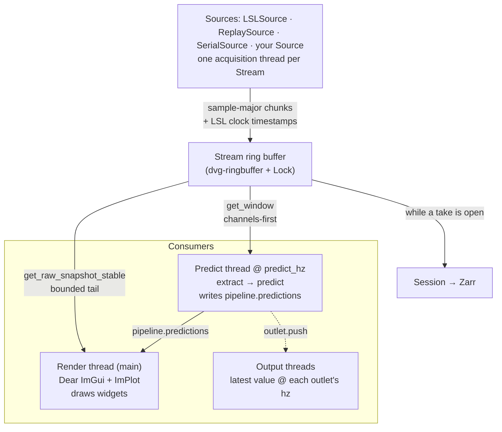

Sources feed ring buffers on acquisition threads. The predict thread computes decisions, and the main thread renders widgets. A `Target` drives a device from a sanitized control frame. Targets or user code can send values through paced outputs.



## Data flow

A typical tick of the system:

1. Acquisition thread for stream `"emg"` reads a chunk from `LSLSource`, appends to the ring buffer, and appends to its Zarr array while a session is attached to that stream. `ctx.session` also holds the most recent stopped take, so it is not the recording flag. It never copies the growing history.
2. Predict thread, once per `1/predict_hz`, pulls a window via the channels-first `Stream.get_window()`, forwards it to `@pipeline.extract`, then to `@pipeline.predict(model, features)`. The returned `dict[str, Any]` is stored in `pipeline.predictions`.
3. The main render thread draws widgets from `ctx`. `SignalViewer` asks for only its visible tail and builds a plot-width-sized min/max envelope. The pose-output filter (`PostProcessor`) renders its panel.
4. Output thread for `LSLOutlet` reads its atomic latest-value slot every `1/hz` and sends it every tick, even if unchanged. Each write replaces the latest value.

On desktop, acquisition, prediction and output loops use daemon threads; rendering stays on the main thread. `Context`, `Pipeline` and the stream buffers hold shared state, with locks around buffer and session access. In the browser playground, acquisition and prediction run as scheduled steps on the GUI frame loop.

## Module map

| Module | Responsibility |
|--------|----------------|
| [`myogestic.core`](../api/core.md) | `App`, `Context`, lifecycle hooks, run loops |
| [`myogestic.stream`](../api/core.md) | `Stream`, ring buffer, acquisition thread, display snapshots |
| [`myogestic.sources`](../api/sources.md) | `LSLSource`, `ReplaySource`, `SerialSource` |
| [`myogestic.outputs`](../api/outputs.md) | `Outlet` base + `LSLOutlet`, the output-side filters |
| [`myogestic.controls`](../api/controls.md) | `Target`, `ControlBus`, `Capability` for driving devices |
| [`myogestic.session`](../api/session.md) | Recording, label tracks, `.mg.zip`, window iterators |
| [`myogestic.ml`](../api/ml.md) | `Pipeline`, train/predict lifecycle, ML widgets |
| [`myogestic.recipes`](../api/models.md) | CatBoost / scikit-learn constructor recipes |
| [`myogestic.widgets`](../api/widgets.md) | Construct-once ImGui widget classes and rendering helpers |
| [`myogestic.outputs.filters`](../api/filters.md) | OneEuro / Gaussian / Identity output smoothers |
| `myogestic.bridges` | Subprocess pattern for webcam and ultrasound sources |

## Public API boundary

Keep these import paths stable. The internal modules `myogestic.core` and `myogestic.stream` are subject to change; user code should import from the package root or named subpackages:

```python
from myogestic import App, Grid, Stream, TrainingData
from myogestic.sources import LSLSource, ReplaySource
from myogestic.outputs import LSLOutlet
from myogestic.ml import Pipeline
from myogestic.session import open_session_store, iter_labeled_windows
from myogestic.widgets import SignalViewer, RecordingControls, SessionManager
```

See [Public API cheatsheet](../reference/api-cheatsheet.md) for the full surface.
