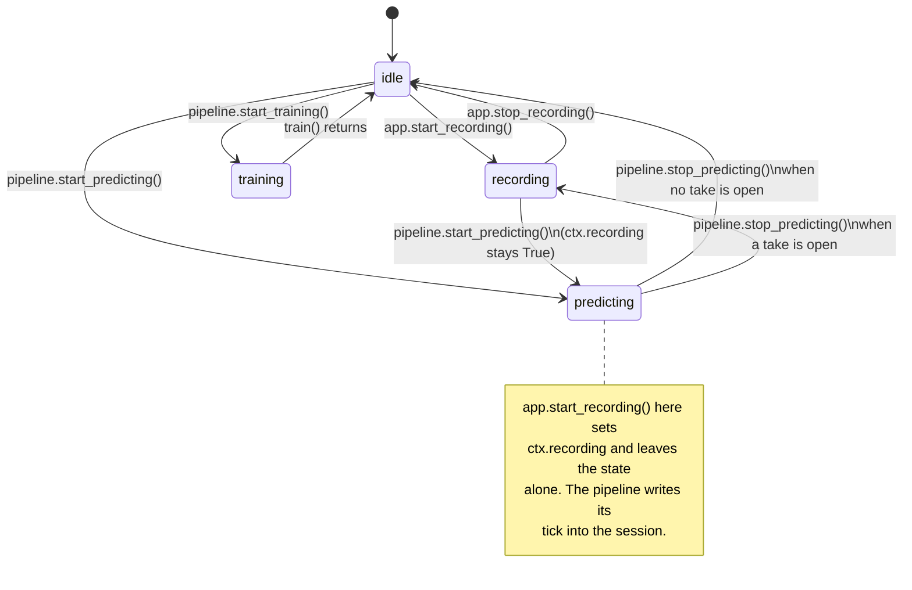

[`Pipeline(app, predict_hz=50)`][myogestic.ml.Pipeline] is the optional ML layer. It adds a predict thread, training/predicting states to `ctx.state`, and three decorators for your ML functions.

```python
from myogestic.ml import Pipeline, save_pickle, load_pickle

pipeline = Pipeline(app, predict_hz=20)
pipeline.save_model = save_pickle
pipeline.load_model = load_pickle


@pipeline.extract
def extract(windows: dict[str, np.ndarray]):
    return windows["emg"]  # whatever shape downstream wants


@pipeline.train
def train(data: TrainingData):
    rows = iter_labeled_windows(data.paths, "emg", window_ms=200, hop_ms=100)
    X, y = ...  # build feature matrix
    return CatBoostClassifier().fit(X, y)


@pipeline.predict
def predict(model, features):
    pred = model.predict(features.reshape(1, -1))[0]
    return {"class": pred}
```


## The three decorators

### `@pipeline.extract`

Runs on the predict thread at `predict_hz` while predicting, when at least one selected input stream has data. Receives a `dict[str, np.ndarray]` keyed by stream name. Each value is channels-first `(n_channels, n_samples)`. Return the input your model needs, such as a feature vector, tuple or raw window. It need not be pickleable.

Call the same function from your `train()` code during training. See `examples/synthetic/emg_classification.py` for examples.

### `@pipeline.train`

Runs on a one-shot training thread when the user clicks Train. Receives one [`TrainingData`][myogestic.TrainingData] instance:

```python
@dataclass
class TrainingData:
    paths: list[str]  # selected session paths (folders or .mg.zip)
    class_names: list[str]  # ordered class labels
    classes: set[int]  # subset selected in the UI
```

Return an object to store on `pipeline.model` and pass to subsequent `predict()` calls. If `pipeline.save_model` is set, the Save Model button calls it as `save_model(pipeline.model, path)`. The persistence helpers [`save_pickle`][myogestic.ml.save_pickle] / [`load_pickle`][myogestic.ml.load_pickle] from `myogestic.ml` provide pickle persistence.

Set `pipeline.training_data` from [`SessionManager`][myogestic.widgets.SessionManager] inside `@app.ui`:

```python
sessions = SessionManager(str(Path("data")), class_names=CLASSES)
with grid[2, 0]:
    pipeline.training_data = sessions.ui()
```

This separation lets the `Train` button stay disabled until at least one session is ticked. It also waits for pending saves and requires an idle app and a training callback.

### `@pipeline.predict`

Runs on the predict thread once the model is loaded and Predict is clicked. Receives `(model, features)` where `features` is the return value of `extract()`. Return a `dict[str, Any]`. Other return types are silently dropped, leaving the previous prediction in `pipeline.predictions`.

Inside `predict()` you typically also push to outputs:

```python
@pipeline.predict
def predict(model, features):
    pose = model.predict(features)
    pose_smooth = pose_filter(pose, timestamp=time.monotonic())
    vhi_outlet.push(pose_smooth)
    return {"pose": pose_smooth}
```

## State machine



`ctx.state` is `training` or `predicting` while the pipeline is busy. Otherwise it is `recording` if a take is open, or `idle`. Training requires `idle`; stop prediction and any open take before Train. The independent `ctx.recording` flag tracks recording. Press Record while predicting to save raw streams, pipeline inputs and outputs, and delivered control frames in one session. See [Recording → Event streams](recording.md#event-streams).

The user-facing UI layer (`PipelinePanel`, `TrainButton`, `PredictButton`) handles transitions; user code rarely calls `start_training()` / `stop_predicting()` directly.

## Pipeline controls

`PipelinePanel(pipeline)` is a model card with a state dot in its header, a tinted
row saying Not trained, Training…, Trained, Predicting, or Training failed,
and one full-width Train action. The prediction rate and failure detail use mono text;
long errors ellipsize with the complete error available on hover. The Predict chip
stays selected while predicting and stops prediction when clicked. Unavailable actions
show a visible caption explaining how to enable them.

The header's log icon appears once output exists. It opens a selectable mono log in a
floating window; `log_height=60` adds an optional compact inline log. `TrainingLog` draws
the same console on its own. Give panels distinct `widget_id` values to keep their controls
and log windows independent.

`TrainButton`, `PredictButton`, `SaveModelButton` and `LoadModelButton` remain available for
custom layouts. Save and Load are secondary icon actions with tooltips naming their path;
their disabled captions explain missing models or callbacks. Their `size=` arguments and
the log heights use logical pixels that follow the UI scale. Saving and loading still use
the path passed to each button and the pipeline's existing save/load callbacks.

## Stale-tick guard

The predict thread wakes every `1/predict_hz`. A slow network or device can delay acquisition. Stateful models, such as state machines or sequence-aware classifiers, need a timestamp to detect repeated data.

```python
@pipeline.extract
def extract(windows):
    emg, ts = emg_stream.get_window()
    last_ts = float(ts[-1]) if ts.size > 0 else None
    return (emg, last_ts)


@pipeline.predict
def predict(model, features):
    emg, last_ts = features
    return model.step(emg, last_ts=last_ts)  # model decides if tick is stale
```

Return the previous prediction from `step()` if `last_ts` hasn't advanced since the last call.

## Lifecycle hooks

`Pipeline` registers itself via `app.before_run_hooks` and `app.cleanup_hooks`. The predict thread runs for the app's lifetime, starting at `app.run()`. While `ctx.state == "predicting"`, it calls `extract` / `predict`. Clicking Predict again returns to `recording` if a take is open, otherwise `idle`. Closing the window signals the thread to stop. Cleanup signals via a `threading.Event` and joins with a short timeout. The pipeline manages the thread.

## Common mistakes

See [Troubleshooting](../troubleshooting.md) for symptoms and fixes.

- Returning a non-dict from `predict()`. Silently dropped. Always return `{"key": value}`.
- Mutating `pipeline.training_data` outside `@app.ui`. It can be set anywhere, but most experiments let `SessionManager` write it from the UI.
- Heavy work inside `extract()` or `predict()`. They run on the predict thread at `predict_hz`. Keep CPU work bounded; offload long jobs to the training thread.
- Forgetting `pipeline.save_model = save_pickle`. The separate save/load buttons stay disabled until their respective callbacks are set; Save also needs a model.
