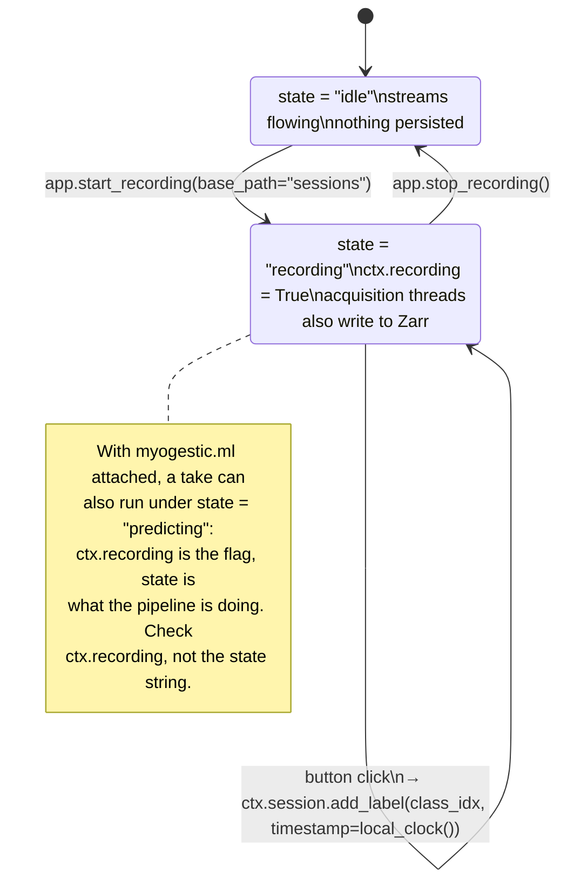

# Recording

Streams always flow. **Recording is just "start appending to Zarr."** Labels are a separate timestamped event track, not interleaved with the signal - that keeps the signal arrays cheap to slice and the labels cheap to scan.

## Mental model



Acquisition threads append each chunk while their stream has an attached session. Stop detaches the streams, freezes event buffers, then finalizes metadata and the archive on a daemon thread.

`ctx.recording` is the truth of "a take is open". It is independent of `ctx.state`: from `idle`, Record moves the state to `recording`; while a `Pipeline` is `predicting`, Record leaves the state alone and sets the flag. `RECORDABLE_STATES` in `myogestic.core` lists the states a take may start from — core registers `idle`, `myogestic.ml` registers `predicting`. `ctx.session` stays set after a stop so the signal viewer can keep drawing the last take's label markers; do not use it as the flag.

## On-disk layout

During recording, one folder per session:

```text
sessions/
└── 2026-05-06_18-46-47/
    ├── meta.json                   # class_names, started_at, model_meta
    ├── labels.json                 # label_track (timestamps + class indices)
    ├── emg.zarr/                   # (n_samples, n_channels) sample-major
    ├── emg_timestamps.zarr/        # (n_samples,) float64 LSL clock
    ├── imu.zarr/                   # if a second stream was recorded
    └── imu_timestamps.zarr/
```

After `stop_recording`, the folder packs to a single archive:

```text
sessions/
├── 2026-05-06_18-46-47/            # original folder (kept until pack succeeds)
└── 2026-05-06_18-46-47.session.zip # archive - contains the same internal layout
```

Both are loadable via [`open_session_store(path)`][myogestic.session.open_session_store] - readers don't need to know which they got.

## Notifications

`App` draws corner toasts automatically after your UI. Call `ctx.notify(title, detail="",
kind="info")` from the UI or a worker thread; each toast also becomes a timestamped
`ctx.log` line.

<!--docs:run-->
```python
from myogestic import Context

ctx = Context()
ctx.notify("Recording saved", "a.session.zip", "success")
assert ctx.logs[-1].endswith("Recording saved — a.session.zip")
```

`success` and `info` last 6 seconds, `warning` lasts 10 seconds, and `danger` stays until
dismissed. Hovering the overlay pauses expiry. At most the newest three toasts appear;
older events remain in the log. Click a toast's **×** to dismiss it. An unknown `kind`
raises `ValueError`.

Stopping a recording reports **Recording saved** with the archive's filename after packing
succeeds. If packing fails, **Recording not packed** shows the error and confirms that
the session folder was kept.

## Labels

`LabelEvent` is a tiny dataclass:

```python
@dataclass
class LabelEvent:
    timestamp: float  # pylsl.local_clock() at the button click
    class_index: int  # -1 = unlabeled (terminator)
```

The label track is a list of these events, persisted to `labels.json` on stop. Each consecutive pair `(events[i], events[i+1])` defines one **trial** - every sample in between is labelled `class_index`. The `-1` terminator at the end marks the boundary of the last trial so iterators know where to stop.

[`RecordingControls`][myogestic.widgets.RecordingControls] writes labels when the user clicks a button:

```python
rec_controls = RecordingControls(
    ["Rest", "Fist", "Open"],
    on_record=app.start_recording,
    on_stop=app.stop_recording,
    on_gesture=lambda idx: ctrl_outlet.push_sample([float(idx)]),
)
rec_controls.ui(ctx)
```

`on_gesture` is yours - typically you forward to a control LSL stream (so a synthetic generator can change pattern), or a robot, or just log it. The label itself is added by `RecordingControls` itself before calling your callback.

## Event streams

A sampled stream has a clock; an event stream has one row per *thing that happened*. `Session.append_event(name, values, timestamp, channel_names=..., fs=...)` declares such a stream on first use and appends one float32 row to it. On disk it is the same `<name>.zarr` / `<name>_timestamps.zarr` pair as any stream, so every reader — `open_session_store`, `ReplaySource`, the window iterators — sees it unchanged. `meta.json` lists these names under `event_streams`, and their `fs` is *nominal* (the producer's tick rate) so `ReplaySource` can pace them; the timestamps are the truth.

Rows are buffered in memory and written 1024 at a time or once a second, whichever comes first, because a single-row zarr append rewrites the partial chunk (about 1.5 ms each on zarr 3.2). `Session.freeze()` flushes every buffer and closes the session to new rows and new streams; `App.stop_recording` calls it before anything is written.

Rows are float32 by default; a value that is itself a clock — an LSL timestamp, `local_clock()` — loses milliseconds at float32 after a day of uptime, so pass `dtype=np.float64` for it (the pipeline does for `pipeline.tick`) or record an offset instead.

With a take open, two producers write event streams for you:

| Stream | Written by | One row per | Timestamp |
|---|---|---|---|
| `features` or `features.<key>` | `Pipeline`, what `@pipeline.extract` returned | predict tick | newest sample the tick consumed |
| `prediction.<key>` | `Pipeline`, what `@pipeline.predict` returned | predict tick | same |
| `pipeline.tick` | `Pipeline`, the LSL `local_clock()` at the decision | predict tick | same — so `tick − timestamp` is the latency |
| `controls` | `ControlBus`, the continuous frame it delivered, DOF names as channels | `push` | delivery clock |
| `controls.<name>` | A second bus with `record_as="controls.<name>"`; its map is saved in `meta.control_spaces` | `push` | delivery clock |

A dict becomes one stream per key. A value is recorded when it is a bool, a number, or a 1-D array; text, `None`, nested dicts and anything 2-D or wider are skipped — once, with a log line, and listed under `extras.pipeline.skipped` in `meta.json`. A raw window returned by `extract` is the recorded stream already; a CNN history is rebuilt from consecutive frames.

For a take that recorded pipeline ticks, `extras.pipeline` identifies it as a Drive run. Takes shows a Drive tag and leaves it unticked for training; the operator can still tick it. Continue → Train selects ordinary takes and skips Drive runs.

On stop, `App.finalize_hooks` run on the finalize thread before `meta.json` is written. The pipeline's hook saves the running model as `model.joblib` beside the arrays (when `pipeline.save_model` is set) and writes `extras.pipeline` with the model type, its `report` if it has one, the event streams, and the skip list.

## Reading recordings

```python
from myogestic.session import open_session_store

sess = open_session_store("sessions/2026-05-06_18-46-47.session.zip")

# Continuous data
data, ts = sess.get_continuous("emg")
# data.shape == (n_samples, n_channels)  - sample-major as recorded

# Per-trial slices (labelled segments)
trials = sess.get_trials("emg", pre_s=0, post_s=0)
# list[Recording] - each has .data, .ts, .class_index, .class_name

# Stream metadata
info = sess.stream_info("emg")  # StreamInfo(n_channels, fs, dtype, channel_names)
```

For training pipelines, two iterators do the slicing for you:

### Classification - [`iter_labeled_windows`][myogestic.session.iter_labeled_windows]

```python
from myogestic.session import iter_labeled_windows

for window, ts, class_idx in iter_labeled_windows(
    data.paths,
    stream_name="emg",
    window_ms=200,
    hop_ms=100,
    classes={0, 1},
):
    feat = rms(window)  # window is (n_channels, n_samples)
    X.append(feat)
    y.append(class_idx)
```

Yields one window per `hop_ms` step, dropping windows that straddle a label boundary so each window has exactly one class. The three-tuple is `(window, ts, class_index)` - `ts` is the matching 1-D timestamp array, in case you need per-sample times for downstream alignment.

### Regression - [`iter_aligned_windows`][myogestic.session.iter_aligned_windows]

```python
from myogestic.session import iter_aligned_windows

for window, aligned, ts in iter_aligned_windows(
    data.paths,
    primary_stream_name="emg",
    aligned_stream_names=["vhi_control"],
    window_ms=200,
    hop_ms=50,
    n_alignment_samples=1,
):
    feat = extract(window)
    target_pose = aligned["vhi_control"]  # shape (n_channels,)
```

Yields the primary window plus a synchronised target snapshot per `aligned_stream_names` entry - handy when the ground truth is a continuous signal (kinematics, torque, joint angles).

## Backends

Zarr is the storage layer. Two compression backends are supported transparently:

- **Pure-Python `zarr`** (default) - works everywhere.
- **`zarrs`** (Rust codec via PyO3, optional via `uv sync --extra zarrs`) - drop-in faster compression for big sessions.

If `zarrs` is installed, the codec is registered on import; if not, recording falls back to plain `zarr` with no code change.

## Common mistakes

See also: full **[Troubleshooting](../troubleshooting.md)** index, organised by symptom across every subsystem.

- **`sess.class_names = [...]` after `save_meta`.** The class names persist only when passed as a kwarg to `save_meta(name, class_names=...)`, not when set as an attribute after the fact. (`RecordingControls` handles this for you when it calls `app.start_recording`.)
- **Treating the label track as a stream.** It isn't - it's events. To iterate "rest periods" by time, slice with the labels and the timestamp arrays manually, or use `iter_labeled_windows`.
- **Single-click sessions.** A session with two clicks (Rest + DOF0) yields exactly one usable trial after the skip-first heuristic. Long cycle-style recordings (rest 3 s → DOF 3 s → rest 3 s → DOF 3 s, etc.) yield many trials per session and produce robust models.
