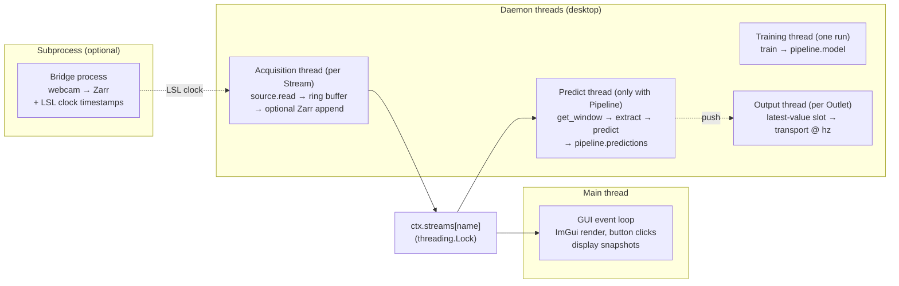

On desktop, acquisition, prediction and sending use stdlib `threading`; the hot path uses no multiprocessing. The browser playground schedules those steps on the GUI frame loop instead of creating OS threads. Bridges isolate heavy-data sources, such as webcams or ultrasound, in subprocesses.

## What runs where




| Thread | Owner | Job |
|--------|-------|-----|
| Main | OS | GUI event loop, ImGui render, button clicks |
| Acquisition (one per `Stream`) | `Stream` | source.read → ring buffer → optional Zarr append |
| Predict | `Pipeline` | extract → predict → write to `pipeline.predictions` |
| Training (transient) | `Pipeline` | train → assign to `pipeline.model` |
| Output (one per `Outlet`) | user-owned `Outlet` | drain `_latest` to its destination at `hz` |
| Bridge subprocess (optional) | `Bridge` | webcam decode → Zarr → publish LSL clock |

The framework's acquisition, prediction, training and output threads are daemons. App cleanup stops an open recording inline and waits up to 30 seconds for pending saves before stopping streams. The predict thread starts at `app.run()` via `app.before_run_hooks`. It does not wait for the first Predict click. Cleanup signals it with a `threading.Event` and joins it with a short timeout. Acquisition and output threads are daemons that exit when the process does; their `stop()` methods set a sentinel but don't `join()`.

<a id="why-the-gil-does-not-serialise-these-threads"></a>

## GIL release

Pure-Python CPU work would serialize these threads under Python's Global Interpreter Lock.
The libraries below move computation and I/O into native code or onto the GPU.

- NumPy releases the GIL inside C extensions (`np.copy`, `np.fft.rfft`, `np.dot`). The ring buffer copy in `get_window` is GIL-released.
- PyTorch CUDA runs on the GPU; the Python thread is mostly waiting for the kernel.
- LSL (`pylsl` and `mne_lsl`) is a C library; `pull_chunk` releases the GIL.
- ImGui / ImPlot are C++; the render thread spends its time in C++ frame building.
- OpenCV, used by `WebCamBridge`, releases the GIL in `cv2.VideoCapture.read`.

Python passes buffers between threads. Computation runs in GIL-released code, allowing parallel work on multi-core machines.

<a id="synchronisation"></a>

## Synchronization

`Context`, `Pipeline` and stream/session objects share state using these conventions:

1. Reference assignment is atomic in CPython. `pipeline.model = trained` doesn't tear; readers either see the old reference or the new one. Same for `pipeline.predictions = {...}`.
2. Ring buffer reads/writes hold a `threading.Lock`. ~1–5 µs overhead per access, compared with µs–ms workload latencies.
3. `ctx.state` transitions go through the App and Pipeline start/stop methods. Callers don't poke `ctx.state = "..."` directly. State changes are point-in-time; there's no "stop in progress" intermediate state.

Stream buffers, attached sessions, event buffers and connection attempts have their own locks. Prediction shutdown uses a `threading.Event`; following runs also have cancellation events. Outputs pass values through a latest-value slot. There is no per-sample queue.

## The GPU contention rule

Prediction pauses while training runs.

```text
ctx.state ∈ {"idle", "recording", "training", "predicting"}
                                    │           │
                                    └─ exclusive ┘
```

Train is disabled while predicting. Stop prediction and any open recording first, then train. When training completes, click Predict to resume.

The state machine refuses concurrent training and prediction to prevent GPU out-of-memory
failures. Managing parallel PyTorch CUDA streams adds complexity that a single-user experiment
app does not need. Prediction throughput is zero during training, which lasts seconds to
minutes. That pause is acceptable for this use case.

## Bridge subprocesses

Heavy-data sources can break the GIL-release assumption. Webcam decoding can saturate a
Python thread even with OpenCV and disrupt prediction. Run heavy-data sources in a subprocess.

```python
cam = WebCamBridge("cam", device=0, zarr_path="session/cam.zarr")
app.bridges(cam)
```

The bridge process:

- Owns a Python interpreter, avoiding GIL contention with the main app.
- Writes frames directly to a Zarr array.
- Publishes one LSL clock timestamp per captured frame for alignment.

The main app never touches the camera frames; it reads per-frame LSL clock timestamps and can look up the corresponding frames in Zarr if the experiment needs them. Registering a bridge does not start it. Call `cam.start()` to start it; `app.run()` stops it on cleanup. The framework does not render a bridge automatically. Use `bridge.status` and `bridge.alive` to display its state. Failed stops are logged.

## Common mistakes

See [Troubleshooting](../troubleshooting.md) for symptoms and fixes.

- `time.sleep` in `@pipeline.predict`. It blocks the predict thread. The framework already paces ticks at `predict_hz`; if you need rate-limiting, change `predict_hz` or use a state machine that returns the previous prediction on stale ticks.
- Touching ImGui from a non-main thread. ImGui is not thread-safe. Widgets only run inside `@app.ui`, which is the render thread. Predict-thread code must NOT call `imgui.*`.
- Long blocking I/O inside a Source's `read`. It pauses acquisition and ring-buffer updates, delaying prediction. Poll without blocking, for example with `pylsl.pull_chunk(timeout=0.0)`.
- Holding the ring buffer lock during compute. The lock is taken inside `get_window` for the copy; release happens before the function returns. User code holds no buffer lock.
