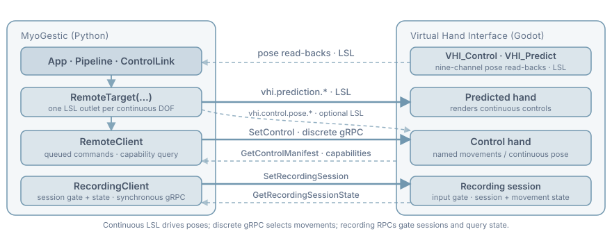

The Virtual Hand Interface (VHI) is a separate Godot-based 3-D hand visualization
application shipped alongside MyoGestic.
It is MyoGestic's [remote target](drive-a-remote-target.md), using LSL for
continuous controls and read-backs, and gRPC for discrete controls.

See [Drive a remote target](drive-a-remote-target.md) for the transport contract,
[Concepts › Controls](../concepts/controls.md) for control maps and
[the control standard](../api/controls.md) for the full rules.

If VHI isn't installed yet, see [Install the Virtual Hand](install-vhi.md).

{ align=center }

`RemoteTarget` publishes continuous controls over LSL and queues discrete `SetControl`
commands through `RemoteClient`. That client queries `GetControlManifest` for control
capabilities. A separate `RecordingClient` calls `SetRecordingSession` to gate recording
and `GetRecordingSessionState` to read session state and the current movement. The
`VHI_Control` and `VHI_Predict` LSL streams return the two hands' poses.

## The one-liner that wires it up

```python
from myogestic.vhi import virtual_hand

vhi = virtual_hand()  # resolves install path + gRPC endpoint
vhi_control = vhi.control_client()  # negotiates the control space (v2)
recording = vhi.recording_client()  # recording session gate + trajectory playback
```

`virtual_hand()` uses an explicit `vhi_path` or `$VHI_PATH` first. Otherwise it looks for
an existing install in the writable checkout, then the per-user install root. It reads `$VHI_GRPC_HOST` / `$VHI_GRPC_PORT` for the control endpoint
(defaults `127.0.0.1:50051`).

The returned [`InterfaceSpec`][myogestic.remote.InterfaceSpec] locates VHI.
It contains no control vocabulary. The running VHI supplies that vocabulary,
so no local table can go stale.
[`RemoteTarget`][myogestic.remote.RemoteTarget] queries the running VHI for its
controls and names each stream by its address:

```python
from myogestic.controls import ControlLink
from myogestic.remote import RemoteTarget

link = ControlLink(CONTROL_MAP, [RemoteTarget(client=vhi_control, interface=vhi)], hz=32)
```

One target drives the whole map, including both hands. You do not name
or count streams yourself.
See [Negotiating with the target](../api/controls.md#negotiating-with-the-target) for what that
resolves and what it refuses, and [Binding retries while the target is
unavailable](../concepts/controls.md#binding-retries-while-the-target-is-unavailable) for why this is a
`ControlLink`. An application with a VHI launch button can bind before VHI starts.

## Launching the VHI process

Drop the launcher into your `ProcessLauncher` panel and the user gets
a Launch/Stop button for VHI:

```python
import sys
from myogestic.widgets import ProcessLauncher

PROCESSES = [
    (
        "EMG Generator",
        [
            sys.executable,
            "-m",
            "myogestic.tools.emg_generator",
            "--name",
            "TestEMG1",
            "--channels",
            "8",
            "--fs",
            "2048",
        ],
    ),
    *vhi.launcher(),
]

launcher = ProcessLauncher(PROCESSES)


@app.ui
def ui(ctx):
    with grid[0, 0]:
        launcher.ui()
```

`vhi.launcher()` prefers a packaged binary install when present, unless
`godot_bin` or `$GODOT_BIN` requests source mode. It falls back to
`godot --path <project>` when a source project and Godot are available. Set
`$VHI_LAUNCH_MODE=binary` or `=godot` to force one.

If VHI is not installed, `launcher()` raises `FileNotFoundError` with the
exact `install_vhi` command to run. Surface this as a status message:

```python
try:
    PROCESSES = [*base, *vhi.launcher()]
except FileNotFoundError as e:
    print(f"[demo] {e}", file=sys.stderr)
    PROCESSES = base  # demo still runs; VHI button just absent
```

### Connect, or launch

`TargetPanel` binds to a running VHI or launches it if none answers.
Place it beside the app's other targets:

```python
from myogestic.controls import ControlLinkConnector
from myogestic.widgets import TargetPanel

connector = ControlLinkConnector(link)
targets = TargetPanel([vhi], connectors={vhi.name: connector}, title="Hands")


@app.ui
def ui(ctx):
    with grid[0, 0]:
        targets.ui()
```

Prediction keeps reading `link.bus`, which is `None` until VHI answers. When VHI
cannot be launched here, the row says so and its tooltip carries the same
install message `launcher()` raises.

## VHI control names

The running VHI's manifest is the authority on its controls.
`uv run --extra grpc python tools/inspect_control_map.py examples/controls/hand.toml`
resolves a map without driving the hand. The address selects the hand:

| address | drives |
|---|---|
| `vhi.prediction.thumb.flexion`, `vhi.prediction.thumb.abduction` | the predicted hand's thumb, two axes |
| `vhi.prediction.index`, `.middle`, `.ring`, `.little` | the predicted hand's other four digits, one axis each |
| `vhi.prediction.wrist.flexion`, `.abduction`, `.rotation` | the predicted hand's wrist |
| `vhi.control.pose.*` | the same digits on the control hand, the one the operator poses and a recording captures |
| `vhi.control.gesture` | the control hand's movement presets, as a discrete control |

`vhi.control.gesture`'s states are whole-hand poses: `Fist`, `ThumbExtension` and the rest of
what that VHI build ships. A preset is a held state and not a number because it commands a
compound shape no single continuous address expresses. VHI supplies the state names, so push
one of *those*; what you write yourself is `debounce_s`, a property of your control loop and
not of the hand.

Sliders can pose the operator's hand while a model drives the predicted one, and a map naming
both is still one `RemoteTarget` and one bus. Each hand has its own addresses.

[`examples/start_here/myocontrol.py`](https://github.com/NsquaredLab/MyoGestic/blob/main/examples/start_here/myocontrol.py)
uses one map and one bus to drive predicted digits from the model
and cue the participant through `vhi.control.gesture` on the control hand.

### The nine channels of a recorded pose

VHI publishes two read-backs, `VHI_Predict` and `VHI_Control`, so a client can see what
actually moved. Both are nine positional float32 channels, whatever the inbound shape. A
recorded session uses this layout, defined by `PredictedHandSkeleton` and
`myogestic.vhi.pose` and verified against recorded sessions:

| Index | Joint            | Notes                                    |
|-------|------------------|------------------------------------------|
| 0     | Thumb flexion    | bones 1/2/3, X axis                      |
| 1     | Thumb abduction  | bones 1/2/3, Z axis                      |
| 2     | Index flexion    |                                          |
| 3     | Middle flexion   |                                          |
| 4     | Ring flexion     |                                          |
| 5     | Little flexion   |                                          |
| 6-8   | Wrist flexion, abduction, rotation | bone 0, which parents every digit |

Measurements established the thumb channel order and wrist behavior.
Channel 0 is thumb flexion; channel 1 is thumb abduction. A recorded fist
has channel 1 at `-1.0` because the thumb crosses the fingers. Channels 6-8
drive the wrist. Archived sessions with these channels hardcoded to `0`
do not contain recorded wrist movement. Those zeros came from the recorder;
VHI does respond to wrist channels.

## A ready-made movement palette

`VhiMovementPanel` packages "fetch control-hand state in the background, render the movement
chips, dispatch clicks" into one widget. The Hand movements header has a refresh action and
a reachability dot; the chips wrap with the available width and mark the current movement.
A mono count appears below them. When the hand is not running, launch instructions and a
Refresh action replace the list. It reads the recording aid for state and takes the
click handler explicitly. Wire that handler to a control-standard DOF (one [degree of
freedom](../reference/glossary.md#dof)), because dispatching straight at the target would
bypass the debounce:

```python
from myogestic.widgets.vhi.panel import VhiMovementPanel

panel = VhiMovementPanel(
    recording,
    lambda state: bus.select("gesture", state),
)


@app.ui
def ui(ctx):
    with grid[8, 0]:
        panel.ui()
```

The handler is where you layer side-effects on a click. Snap a session label, drive a fake
generator, whatever the experiment needs:

```python
def _on_movement_click(name: str) -> None:
    ctrl_outlet.push_sample(...)  # e.g. drive the EMG generator
    bus.select("gesture", name)  # deliver + rebase the debounce
```

[`bus.select`](../concepts/controls.md#continuous-and-discrete-are-different-things)
delivers the state immediately and rebases the DOF's stability gate to prevent
predict ticks from repeating the button action.

## Driving the control hand as ground truth

Some workflows want the control hand to move on its own so the recorded kinematics sweep a
range. Continuous regression is one, where the control hand is the *regression target* the
model learns. The recording aid is for that:

```python
recording.start_trajectory("Fist", frequency_hz=0.7)  # cycles, producing a trajectory
...
recording.stop_trajectory()  # stops and rests the hand
```

While a trajectory runs it owns the control hand, and discrete DOFs are refused with a reason;
nothing silently interrupts it. See [Recording is not
control](../api/controls.md#recording-is-not-control) for why the sweep lives here and not in
the control standard.

Wrap a recording in the session gate so VHI's local keyboard cannot compete as a
movement source:

```python
def _on_record() -> None:
    app.start_recording()
    if not recording.set_recording_session(True):
        app.ctx.log("no VHI recording gate — the keyboard is not blocked")
```

The call returns `False` without raising when the aid is unavailable.
Decide whether an ungated recording is acceptable for your experiment.
This is an experiment-integrity decision for the caller, so the client does
not make it by raising.

## Testing without VHI

`print` is the cheapest viewer:

```python
@pipeline.predict
def predict(model, features):
    pose = model.compose_pose(features)
    print(f"pose: {[f'{v:+.2f}' for v in pose]}")
    return {"pose": pose}
```

Or point `uv run mne-lsl viewer -s vhi.prediction.index` at a single DOF
going out, `VHI_Predict` for all nine coming back. For the gRPC plane, the standard `grpcurl`
works against the local server when VHI is running. The proto is at
`myogestic/remote/_proto/remote_control.proto`.

`tools/inspect_control.py` checks declaration, resolution and wire frames
without launching the Virtual Hand. It also shows target behaviour when VHI is absent.

## Common mistakes

See the full [Troubleshooting](../troubleshooting.md) index for
symptom-organized debugging, and
[Controls › Common mistakes](../concepts/controls.md#common-mistakes) for the ones that are
about the control standard.

* Forgetting `set_recording_session(False)` on session end. VHI keeps ignoring its
  own keyboard until you toggle it back.
* Leaving a recording trajectory running. It keeps the control hand moving and
  refuses discrete DOFs. `stop_trajectory()` is idempotent, so call it in teardown
  regardless.
* Forgetting `pose_filter.reset()` on retrain. The first few smoothed
  frames blend the new model's first prediction with the old model's
  last; looks like a brief pose drift on every train cycle. See
  [Post-process predictions](post-process-output.md).

## See also

* [Install the Virtual Hand](install-vhi.md) - the installer CLI.
* [Drive a remote target](drive-a-remote-target.md) - the contract VHI serves, and what MyoGestic
  calls on it.
* [Control standard](../api/controls.md) - declaring a map, negotiation, the three layers
  of smoothing.
* [Edge trigger](../concepts/edge-trigger.md) - fire-on-change pattern.
* [Examples directory](../tutorials/examples-index.md) - runnable protocols,
  including those that wire VHI over LSL and gRPC.
* [`myogestic.vhi.virtual_hand`](../api/core.md) - full signature.
* [`myogestic.widgets.vhi.panel.VhiMovementPanel`](../api/widgets.md) -
  movement palette API.
