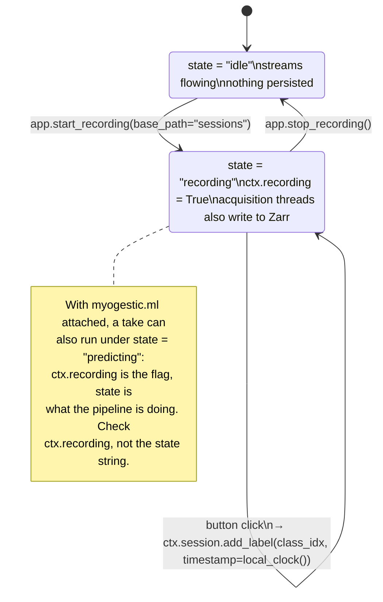
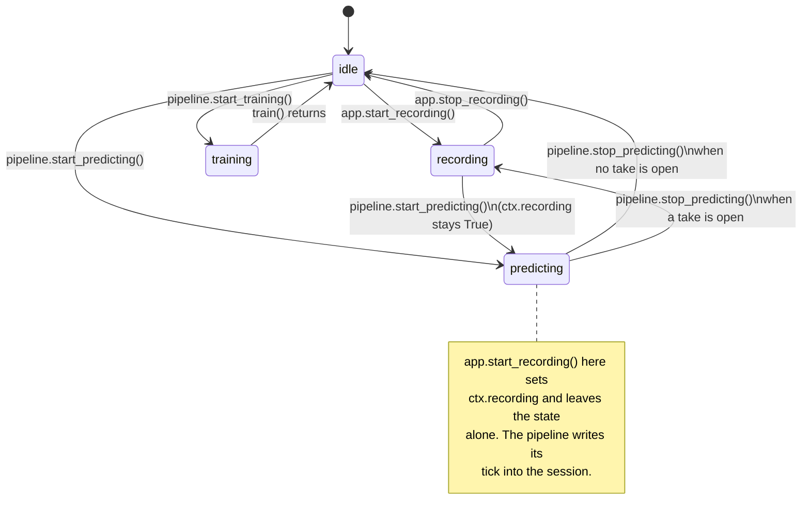

# Record While Predicting Implementation Plan

> **For agentic workers:** REQUIRED SUB-SKILL: Use superpowers:subagent-driven-development (recommended) or superpowers:executing-plans to implement this plan task-by-task. Steps use checkbox (`- [ ]`) syntax for tracking.

**Goal:** A recording can run while a model predicts, and the session then carries the raw streams, the pipeline's per-tick input and output, the delivered control frames, and the model itself.

**Architecture:** Recording becomes a `Context.recording` flag orthogonal to the pipeline's `predicting` state, gated by a `RECORDABLE_STATES` registry the ML extension adds itself to. `Session.append_event` gives every producer a buffered, lazily declared per-tick zarr stream behind one lock, and `Session.freeze()` closes the session to new rows before anything is written. The pipeline and the control bus write into whatever session is open; `App.finalize_hooks` let the pipeline save the model beside it, on the existing finalize thread.

**Tech Stack:** Python 3.12, numpy, zarr 3.x, imgui-bundle, pytest. No new dependencies.

**Spec:** `docs/superpowers/specs/2026-09-13-record-while-predicting-design.md`

## Global Constraints

- Repo: `~/code/myogestics/MyoGestic-main`, package dir `myogestic/`, tests in `tests/`. Work on a branch off `main`; never push.
- Run tests with `uv run --locked --extra dev --extra grpc pytest -q <path>`; lint with `uv run --locked --extra dev ruff check .` and `ruff format`. `--locked` means: add no dependencies.
- `ruff` line length is 100, target `py312`. Match the surrounding docstring style (numpydoc sections, prose that says *why*).
- Nothing added here may raise into the predict loop, the acquire loop, or the control bus. Every failure path logs once and degrades to "not recorded".
- Event stream names: `features`, `features.<key>`, `prediction.<key>`, `pipeline.tick`, `controls`. Event chunk size 1024 rows, flush after 1.0 s. Event streams carry a **nominal** `fs` (`predict_hz`, bus `hz`), never `0`.
- `AppState.RECORDING`, `can_transition`, `Session.append`, `Session.init_stream`'s positional signature, and every widget constructor keep their contracts.
- Commits: conventional prefixes as in `git log` (`feat(session): …`, `fix(core): …`, `docs: …`), gpg-signed (the repo config does it), and end with `Co-Authored-By: Claude Fable 5.1 <noreply@anthropic.com>`.
- Version stays `2.6.2` in `pyproject.toml`; the release commit bumps it. The changelog goes under `[Unreleased]`.

---

## File structure

| File | Responsibility after this plan |
|---|---|
| `myogestic/session/_core.py` | `Session` gains buffered event streams (`append_event`, `freeze`, `event_streams`), `init_stream(chunk_rows=)`, `event_streams` in `meta.json` |
| `myogestic/session/_io.py` | `open_session_store` restores the event-stream attributes on a loaded session |
| `myogestic/core.py` | `Context.recording`, `RECORDABLE_STATES`, `App.finalize_hooks`, flag-based `start/stop/discard_recording`, `stop_recording(wait=)`, `App._cleanup()` stops an open take |
| `myogestic/ml/pipeline.py` | registers `predicting` as recordable, records each tick, saves the model on finalize |
| `myogestic/_controls_bus.py` | `ControlBus(ctx=)`, records delivered frames; `connect_controls` passes `ctx` |
| `myogestic/widgets/panels/recording.py` | `_transport(ctx)` helper, `REC` pill, freeze at the Stop click |
| `myogestic/widgets/signals/device_picker.py`, `myogestic/widgets/panels/stream_manager.py`, `myogestic/ml/widgets.py` | read the flag / allow Predict from `recording` |
| `tests/test_session_events.py` (new), `tests/test_core.py`, `tests/test_ml_recording.py` (new), `tests/test_control_bus.py`, `tests/test_recording_widget.py` | coverage per task |
| `docs/concepts/recording.md`, `docs/concepts/pipeline.md`, `docs/how-to/record-and-replay.md`, `CHANGELOG.md` | documentation |

---

### Task 0: The branch

- [ ] **Step 1: Branch off `main`**

The spec and this plan were committed on local `main` (`09fe31c`, `16af4b9`); the code goes on a branch. The working tree also carries three pre-existing modified plan docs under `docs/superpowers/plans/` that belong to nobody's commit here: always `git add` explicit paths, never `-a` or `.`.

```bash
cd ~/code/myogestics/MyoGestic-main
git switch -c feat/record-while-predicting
git status --short   # expect only the three modified plan docs, untouched
```

---

### Task 1: `Session.append_event`, `freeze`, buffered flush

**Files:**
- Modify: `myogestic/session/_core.py` (imports at 1-27; `Session.__init__` 227-268; `init_stream` 270-287; `append` 288-301; `save_meta` 318-375; `pack_to_zip` 377-428; `discard` 430-441)
- Modify: `myogestic/session/_io.py:52-100` (`open_session_store`)
- Test: `tests/test_session_events.py` (new)

**Interfaces:**
- Consumes: `StreamInfo(n_channels, fs, dtype, channel_names)` from `myogestic.stream`; existing `Session.init_stream/append/save_meta/pack_to_zip/discard`.
- Produces:
  - `Session.append_event(name: str, values, timestamp: float, *, channel_names: Sequence[str] | None = None, fs: float = 1.0) -> None`
  - `Session.freeze() -> None` (idempotent)
  - `Session.event_streams -> tuple[str, ...]`
  - `Session.init_stream(stream_name, info, *, chunk_rows: int | None = None)`
  - module constants `EVENT_CHUNK_ROWS = 1024`, `EVENT_FLUSH_SECONDS = 1.0`
  - `meta.json` key `"event_streams": [str]`

- [ ] **Step 1: Write the failing tests**

Create `tests/test_session_events.py`:

```python
"""Event streams: buffered per-tick rows declared on first use, closed by freeze()."""

from __future__ import annotations

import json
import tempfile
import zipfile

import numpy as np
import pytest

from myogestic.session import Session, open_session_store
from myogestic.session import _core
from myogestic.sources.replay import ReplaySource
from myogestic.stream import StreamInfo


def _session(tmp) -> Session:
    session = Session(base_path=tmp)
    session.init_stream("emg", StreamInfo(n_channels=2, fs=100.0))
    session.append("emg", np.zeros((10, 2), np.float32), np.arange(10.0))
    return session


def test_first_row_declares_the_stream_and_stays_buffered():
    with tempfile.TemporaryDirectory() as tmp:
        s = _session(tmp)
        s.append_event("prediction.pose", [0.5, -0.25, 1.0], 12.5, channel_names=["a", "b", "c"], fs=32.0)
        info = s.stream_info("prediction.pose")
        assert (info.n_channels, info.fs, info.channel_names) == (3, 32.0, ["a", "b", "c"])
        assert s.event_streams == ("prediction.pose",)
        assert s.stores["prediction.pose"].shape == (0, 3)  # buffered, not yet written
        assert s.stores["prediction.pose"].chunks == (_core.EVENT_CHUNK_ROWS, 3)
        s.freeze()
        assert np.array(s.stores["prediction.pose"]).tolist() == [[0.5, -0.25, 1.0]]
        assert np.array(s.ts_stores["prediction.pose"]).tolist() == [12.5]
        assert s.ts_stores["prediction.pose"].dtype == np.float64


def test_a_row_of_another_width_is_refused():
    with tempfile.TemporaryDirectory() as tmp:
        s = _session(tmp)
        s.append_event("x", [1.0, 2.0], 0.0)
        with pytest.raises(ValueError, match="2 wide"):
            s.append_event("x", [1.0], 1.0)
        with pytest.raises(ValueError, match="sampled stream"):
            s.append_event("emg", [1.0, 2.0], 1.0)


def test_the_buffer_flushes_at_the_chunk_size():
    with tempfile.TemporaryDirectory() as tmp:
        s = _session(tmp)
        for i in range(_core.EVENT_CHUNK_ROWS):
            s.append_event("x", [float(i)], float(i))
        assert s.stores["x"].shape == (_core.EVENT_CHUNK_ROWS, 1)  # written without freeze
        s.append_event("x", [9.0], 9.0)
        assert s.stores["x"].shape == (_core.EVENT_CHUNK_ROWS, 1)  # the new row is buffered


def test_the_buffer_flushes_after_one_second(monkeypatch):
    with tempfile.TemporaryDirectory() as tmp:
        s = _session(tmp)
        clock = [100.0]
        monkeypatch.setattr(_core.time, "monotonic", lambda: clock[0])
        s.append_event("x", [1.0], 0.0)
        clock[0] += 0.5
        s.append_event("x", [2.0], 0.5)
        assert s.stores["x"].shape == (0, 1)
        clock[0] += 0.6  # oldest buffered row is now 1.1 s old
        s.append_event("x", [3.0], 1.1)
        assert s.stores["x"].shape == (3, 1)


def test_after_freeze_rows_are_dropped_and_no_stream_can_be_declared():
    with tempfile.TemporaryDirectory() as tmp:
        s = _session(tmp)
        s.append_event("x", [1.0], 0.0)
        s.freeze()
        s.append_event("x", [2.0], 1.0)
        s.append_event("late", [1.0], 1.0)
        s.append("emg", np.ones((5, 2), np.float32), np.arange(5.0))
        assert s.stores["x"].shape == (1, 1)
        assert "late" not in s.stores and s.event_streams == ("x",)
        assert s.stores["emg"].shape == (10, 2)
        s.freeze()  # idempotent


def test_event_streams_survive_pack_and_replay():
    with tempfile.TemporaryDirectory() as tmp:
        s = _session(tmp)
        for i in range(70):
            s.append_event("controls", [i / 70, 1.0], 100.0 + i / 32, channel_names=["a", "g"], fs=32.0)
        s.save_meta("EventsTest")
        zip_path = s.pack_to_zip()  # freezes, flushes, packs
        with zipfile.ZipFile(zip_path) as zf:
            meta = json.loads(zf.read("meta.json"))
        assert meta["event_streams"] == ["controls"]
        assert meta["streams"]["controls"]["fs"] == 32.0
        with open_session_store(zip_path) as loaded:
            assert loaded.event_streams == ("controls",)
            assert loaded.stream_info("controls").fs == 32.0
            assert np.array(loaded.stores["controls"]).shape == (70, 2)
            loaded.freeze()  # a loaded session is read-only; freeze must be a no-op, not an error
        source = ReplaySource(str(zip_path), "controls")
        info = source.connect()
        data, ts = source.read()  # first read hands over the initial chunk immediately
        source.disconnect()
        assert info.fs == 32.0 and data.shape[1] == 2 and len(ts) > 0
```

- [ ] **Step 2: Run the tests to verify they fail**

Run: `uv run --locked --extra dev --extra grpc pytest -q tests/test_session_events.py`
Expected: FAIL, `AttributeError: 'Session' object has no attribute 'append_event'`.

- [ ] **Step 3: Implement event streams in `myogestic/session/_core.py`**

Add `import threading` to the imports (after `import sys`). Add `Sequence` to the `collections.abc` import. Add, after `POSE_CONVENTION` (line 46):

```python
#: Rows an event stream buffers before one batched zarr write. Measured on zarr 3.2.1: a
#: single-row append into a partially filled chunk costs ~1.5 ms (read, decompress, rewrite,
#: recompress the chunk); 32 rows appended at once cost ~0.04 ms per row. The predict thread
#: has a 31 ms budget per tick and may feed ten of these streams.
EVENT_CHUNK_ROWS = 1024
#: A buffer older than this is flushed on the next append, whatever its size, so a quiet
#: stream still reaches disk within a second.
EVENT_FLUSH_SECONDS = 1.0


@dataclass
class _EventBuffer:
    rows: list[np.ndarray] = field(default_factory=list)
    times: list[float] = field(default_factory=list)
    since: float | None = None  # time.monotonic() of the oldest buffered row
```

Add `field` to the dataclasses import. In `Session.__init__`, after `self._zip_store = None`:

```python
        # Event streams: one row per tick from the pipeline or the bus, declared on first
        # use and buffered (see EVENT_CHUNK_ROWS). One lock covers declaration, buffering,
        # flush and freeze, because the predict thread, the UI thread and the finalise
        # thread all reach these.
        self._event_lock = threading.Lock()
        self._event_buffers: dict[str, _EventBuffer] = {}
        self._event_streams: list[str] = []
        #: Set by freeze(): no row is accepted and no stream declared after it.
        self._finalising = False
```

Change `init_stream` to accept a chunk size:

```python
    def init_stream(
        self, stream_name: str, info: StreamInfo, *, chunk_rows: int | None = None
    ) -> None:
        """Called once per stream when recording starts.

        ``chunk_rows`` sizes the zarr chunk; the default is one second of samples. Event
        streams pass `EVENT_CHUNK_ROWS` because their rate is nominal.
        """
        rows = max(1, int(info.fs) if chunk_rows is None else int(chunk_rows))
        self._streams_info[stream_name] = info
        self.stores[stream_name] = zarr.open_array(
            str(self.path / f"{stream_name}.zarr"),
            mode="w",
            shape=(0, info.n_channels),
            chunks=(rows, info.n_channels),
            dtype=info.dtype,
        )
        self.ts_stores[stream_name] = zarr.open_array(
            str(self.path / f"{stream_name}_timestamps.zarr"),
            mode="w",
            shape=(0,),
            chunks=(rows,),
            dtype=np.float64,
        )
```

At the top of `append`, before the store lookup:

```python
        if self._finalising:
            log.debug("dropping late append for frozen session %s", self.path)
            return
```

Add the new methods after `append`:

```python
    @property
    def event_streams(self) -> tuple[str, ...]:
        """Names of the event streams, in declaration order. One row per tick, nominal rate."""
        return tuple(self._event_streams)

    def append_event(
        self,
        name: str,
        values: Any,
        timestamp: float,
        *,
        channel_names: Sequence[str] | None = None,
        fs: float = 1.0,
    ) -> None:
        """Append one timestamped row to an event stream, declaring it on first use.

        ``values`` is flattened to ``float32``; its width is fixed by the first call, and a
        later row of another width raises ``ValueError`` so a producer whose shape changed
        learns it once instead of writing a ragged array. ``fs`` is the *nominal* rate the
        declaration carries, so `ReplaySource` can pace the stream; the rows are irregular
        and ``meta.json`` lists the stream under ``event_streams`` to say so.

        Rows are buffered and written in batches (`EVENT_CHUNK_ROWS`, `EVENT_FLUSH_SECONDS`).
        After `freeze` a row is dropped with a debug log, like a late `append`.
        """
        row = np.asarray(values, dtype=np.float32).ravel()
        if row.size == 0:
            raise ValueError(f"{name!r}: an event row needs at least one value")
        with self._event_lock:
            if self._finalising:
                log.debug("dropping event row for frozen session %s", self.path)
                return
            buf = self._event_buffers.get(name)
            if buf is None:
                if name in self.stores:
                    raise ValueError(f"{name!r} is a sampled stream, not an event stream")
                from myogestic.stream import StreamInfo

                self.init_stream(
                    name,
                    StreamInfo(
                        n_channels=int(row.size),
                        fs=float(fs),
                        dtype=np.dtype(np.float32),
                        channel_names=list(channel_names) if channel_names else None,
                    ),
                    chunk_rows=EVENT_CHUNK_ROWS,
                )
                self._event_streams.append(name)
                buf = self._event_buffers[name] = _EventBuffer()
            width = self._streams_info[name].n_channels
            if row.size != width:
                raise ValueError(f"{name!r} rows are {width} wide, got {row.size}")
            now = time.monotonic()
            buf.rows.append(row)
            buf.times.append(float(timestamp))
            if buf.since is None:
                buf.since = now
            if len(buf.rows) >= EVENT_CHUNK_ROWS or now - buf.since >= EVENT_FLUSH_SECONDS:
                self._flush_locked(name, buf)

    def _flush_locked(self, name: str, buf: _EventBuffer) -> None:
        """Write a buffer as one batch. Caller holds ``_event_lock``."""
        if not buf.rows:
            return
        self.stores[name].append(np.stack(buf.rows))
        self.ts_stores[name].append(np.asarray(buf.times, dtype=np.float64))
        buf.rows.clear()
        buf.times.clear()
        buf.since = None

    def freeze(self) -> None:
        """Close the session to new rows and flush every event buffer. Idempotent.

        `App.stop_recording` calls this right after detaching the streams and before any
        finalize hook or ``meta.json`` is written, so nothing can declare a stream that the
        metadata does not list. `pack_to_zip` and `discard` call it as well.
        """
        with self._event_lock:
            if self._finalising:
                return
            self._finalising = True
            for name, buf in self._event_buffers.items():
                self._flush_locked(name, buf)
```

In `save_meta`, add to the `meta` dict after the `"streams"` entry:

```python
            "event_streams": list(self._event_streams),
```

In `pack_to_zip`, as the first statement of the body (before `self.stores.clear()`): `self.freeze()`. Same in `discard`.

In `myogestic/session/_io.py`, `open_session_store`, after `session._zip_store = zip_store`:

```python
    # A loaded session is read-only: frozen, with no buffers, so freeze() is a no-op and
    # append_event drops instead of raising AttributeError on the attributes __init__ set.
    session._event_lock = threading.Lock()
    session._event_buffers = {}
    session._event_streams = list(meta.get("event_streams") or [])
    session._finalising = True
```

and add `import threading` to that module's imports.

- [ ] **Step 4: Run the tests to verify they pass**

Run: `uv run --locked --extra dev --extra grpc pytest -q tests/test_session_events.py tests/test_session_pack.py tests/test_replay_source.py tests/test_recording_race.py`
Expected: all PASS.

- [ ] **Step 5: Lint and commit**

```bash
uv run --locked --extra dev ruff format myogestic/session tests/test_session_events.py
uv run --locked --extra dev ruff check myogestic/session tests/test_session_events.py
git add myogestic/session/_core.py myogestic/session/_io.py tests/test_session_events.py
git commit -m "feat(session): buffered event streams, declared on first use, closed by freeze()

One row per tick from the pipeline or the control bus, into the same zarr pair
every reader already understands. Rows are buffered because a single-row zarr
append rewrites the partial chunk (measured 1.46 ms each on zarr 3.2.1, 0.04 ms
per row batched). freeze() flushes and closes the session so nothing declares a
stream after meta.json lists them.

Co-Authored-By: Claude Fable 5.1 <noreply@anthropic.com>"
```

---

### Task 2: Recording is a flag; finalize hooks; finalize off the UI thread; stop at exit

**Files:**
- Modify: `myogestic/core.py` (`Context` docstring + fields 141-190; `TRANSITIONS` 114-117; `App.__init__` hook lists 269-270; `start_recording` 398-443; `stop_recording` 444-505; `discard_recording` 507-545; `run`'s `_do_cleanup` closure ~586-610)
- Test: `tests/test_core.py`

**Interfaces:**
- Consumes: `Session.freeze()`, `Session.event_streams` (Task 1).
- Produces:
  - `myogestic.core.RECORDABLE_STATES: set[str]` (initially `{AppState.IDLE}`)
  - `Context.recording: bool`
  - `App.finalize_hooks: list[Callable[[Session], None]]`
  - `App.stop_recording(*, wait: bool = False)`
  - `App._cleanup()` (the former `_do_cleanup` closure, now a method `run()` calls)

- [ ] **Step 1: Write the failing tests**

Append to `tests/test_core.py`:

```python
# --- recording as a flag beside the state ------------------------------------------
import json
import zipfile
from pathlib import Path

import numpy as np
import pytest

from myogestic.core import RECORDABLE_STATES
from myogestic.stream import StreamInfo


class _FakeSource:
    def connect(self) -> StreamInfo:
        return StreamInfo(n_channels=4, fs=100.0)

    def read(self):
        return None, None

    def disconnect(self) -> None:
        pass


@pytest.fixture
def recordable_predicting():
    """Register 'predicting' the way myogestic.ml does, and undo it afterwards."""
    before = set(RECORDABLE_STATES)
    RECORDABLE_STATES.add("predicting")
    yield
    RECORDABLE_STATES.clear()
    RECORDABLE_STATES.update(before)


def _connected_app() -> tuple[App, Stream]:
    app = App("flag-test")
    stream = Stream("emg", source=_FakeSource(), window_ms=100)
    app.streams(stream)
    assert stream.reconnect()
    return app, stream


def _only_zip(folder: Path) -> Path:
    zips = list(folder.glob("*.session.zip"))
    assert len(zips) == 1, zips
    return zips[0]


def test_recording_while_predicting_leaves_the_state_alone(tmp_path, recordable_predicting):
    app, stream = _connected_app()
    app.ctx.state = "predicting"
    app.start_recording(str(tmp_path))
    assert app.ctx.recording is True
    assert app.ctx.state == "predicting"
    assert stream._session is app.ctx.session
    app.stop_recording(wait=True)
    assert app.ctx.recording is False
    assert app.ctx.state == "predicting"
    assert stream._session is None
    assert _only_zip(tmp_path).exists()


def test_recording_from_idle_still_shows_the_recording_state(tmp_path):
    app, _ = _connected_app()
    app.start_recording(str(tmp_path))
    assert (app.ctx.recording, app.ctx.state) == (True, "recording")
    app.stop_recording(wait=True)
    assert (app.ctx.recording, app.ctx.state) == (False, "idle")


def test_start_recording_is_refused_outside_recordable_states(tmp_path):
    app, _ = _connected_app()
    app.ctx.state = "training"
    app.start_recording(str(tmp_path))
    assert app.ctx.recording is False
    assert "Cannot start recording" in app.ctx.status_message
    assert not list(tmp_path.iterdir())


def test_finalize_hooks_run_after_freeze_and_before_meta(tmp_path):
    app, _ = _connected_app()
    seen = {}

    def hook(session):
        seen["event_streams"] = session.event_streams
        session.extras["hook"] = "ran"
        session.append_event("late", [1.0], 0.0)  # must be dropped: the session is frozen

    app.finalize_hooks.append(hook)
    app.start_recording(str(tmp_path))
    app.ctx.session.append_event("prediction.x", [1.0], 0.0)
    app.stop_recording(wait=True)
    with zipfile.ZipFile(_only_zip(tmp_path)) as zf:
        meta = json.loads(zf.read("meta.json"))
        names = zf.namelist()
    assert seen["event_streams"] == ("prediction.x",)
    assert meta["extras"]["hook"] == "ran"
    assert "late" not in meta["streams"] and not any(n.startswith("late.zarr") for n in names)


def test_a_failing_finalize_hook_does_not_lose_the_take(tmp_path):
    app, _ = _connected_app()
    app.finalize_hooks.append(lambda session: 1 / 0)
    app.start_recording(str(tmp_path))
    app.stop_recording(wait=True)
    assert _only_zip(tmp_path).exists()
    assert any("Finalize hook failed" in line for line in app.ctx.logs)


def test_discard_while_predicting_runs_no_hook(tmp_path, recordable_predicting):
    app, _ = _connected_app()
    app.finalize_hooks.append(lambda session: pytest.fail("hook ran on discard"))
    app.ctx.state = "predicting"
    app.start_recording(str(tmp_path))
    app.discard_recording()
    assert (app.ctx.recording, app.ctx.state, app.ctx.session) == (False, "predicting", None)
    assert not list(tmp_path.iterdir())


def test_cleanup_finalises_an_open_take(tmp_path):
    app, _ = _connected_app()
    app.start_recording(str(tmp_path))
    app._cleanup()
    assert app.ctx.recording is False
    assert _only_zip(tmp_path).exists()
```

- [ ] **Step 2: Run the tests to verify they fail**

Run: `uv run --locked --extra dev --extra grpc pytest -q tests/test_core.py -k "flag or recordable or finalize or discard_while or cleanup_finalises or recording_from_idle"`
Expected: FAIL, `ImportError: cannot import name 'RECORDABLE_STATES'`.

- [ ] **Step 3: Implement in `myogestic/core.py`**

After `TRANSITIONS` (line 117):

```python
#: States a recording may start in. Core knows only ``idle``; an extension whose state is
#: compatible with a take registers it here — ``myogestic.ml`` adds ``"predicting"`` when a
#: `Pipeline` is constructed, the same way it registers its pill colours. Process-global,
#: like that registry: a test asserting refusal from a registered state must snapshot and
#: restore this set.
RECORDABLE_STATES: set[str] = {AppState.IDLE}
```

In `Context`: rewrite the `session` docstring entry, which is now wrong on both counts:

```
    session
        The `Session` of the current or most recent take. Set by `App.start_recording`
        and kept after `stop_recording` so the signal viewer can go on drawing that
        take's label markers; `discard_recording` clears it. Whether a take is *open*
        is `recording`, not this.
```

and add after it:

```
    recording
        ``True`` while a `Session` is open and the streams append to it. Independent of
        `state`: a take can run under ``"predicting"``. This is what to check to know
        whether a recording is on; ``session`` stays set after a stop so the viewer can
        keep drawing the last take's markers.
```

and the field, after `session: Session | None = None`:

```python
    recording: bool = False
```

In `App.__init__`, after `self.cleanup_hooks = []`:

```python
        #: Called with the `Session` when a recording stops, on the finalize thread, after
        #: `Session.freeze` and before ``meta.json`` is written — so a hook can add to
        #: ``session.extras`` or drop a file into ``session.path``. `myogestic.ml.Pipeline`
        #: saves the running model here. Not called on `discard_recording`.
        self.finalize_hooks: list[Callable[[Session], None]] = []
```

Replace the guard and state assignment at the top of `start_recording` (the `can_transition` check through `self.ctx.state = AppState.RECORDING`):

```python
        if self.ctx.recording:
            self.ctx.status_message = "Cannot start recording: already recording."
            return
        if self.ctx.state not in RECORDABLE_STATES:
            allowed = ", ".join(repr(s) for s in sorted(RECORDABLE_STATES))
            self.ctx.status_message = (
                f"Cannot start recording: state is {self.ctx.state!r}, expected {allowed}."
            )
            return
        # A stream with info=None has no zarr schema and would fail on append.
        self.ctx.recording = True
        if self.ctx.state == AppState.IDLE:
            self.ctx.state = AppState.RECORDING
```

Update its docstring's last sentence to: "Refuses to start while a take is already open or when ``ctx.state`` is not in `RECORDABLE_STATES`; updates ``ctx.status_message`` with the result."

Replace `stop_recording` entirely:

```python
    def stop_recording(self, *, wait: bool = False) -> None:
        """Stop the active recording and pack the session to a ``.session.zip``.

        Detaches every stream and freezes the session on the calling thread, then on a
        daemon thread runs `finalize_hooks`, writes ``meta.json`` and ``labels.json``,
        packs the folder into ``<timestamp>.session.zip`` (the folder is kept until the
        pack succeeds) and registers the archive with the session browser. ``wait=True``
        does that work inline instead — for tests, and for shutdown, where a daemon would
        die with the archive half written. Refuses if no recording is open.
        """
        if not self.ctx.recording:
            self.ctx.status_message = (
                f"Cannot stop recording: state is {self.ctx.state!r}, no recording is open."
            )
            return
        self.ctx.recording = False
        if self.ctx.state == AppState.RECORDING:
            self.ctx.state = AppState.IDLE
        # Detach every stream *before* finalising/packing. detach_session() waits for
        # any in-flight append on the acquire thread, so the finalize thread below can
        # clear the Zarr stores without racing the acquire loop.
        for stream in self.ctx.streams.values():
            stream.detach_session()
        session = self.ctx.session
        if session is None:
            return
        # Freeze before anything is written: a late event row cannot declare a stream
        # that meta.json will not list.
        session.freeze()
        controls = self.ctx.control_space
        class_names = self.ctx.class_names or None
        hooks = list(self.finalize_hooks)
        self.ctx.status_message = "Finalizing…"

        def _finalize() -> None:
            for hook in hooks:
                try:
                    hook(session)
                except Exception as e:
                    log.exception("finalize hook %r failed: %s", hook, e)
                    self.ctx.log(f"Finalize hook failed: {e}")
            try:
                session.save_meta(
                    self.name,
                    class_names=class_names,
                    control_space=controls.as_control_space() if controls is not None else None,
                )
                n = len(session.label_track)
                zip_path = session.pack_to_zip()
                self.ctx.status_message = f"Saved {n} labels"
                self.ctx.log(f"Session saved → {zip_path}")
                from myogestic.widgets.training.session_manager import add_recorded_session

                add_recorded_session(str(zip_path))
                log.info("packed session to %s", zip_path)
            except Exception as e:
                log.exception("finalize failed: %s", e)
                self.ctx.status_message = f"Pack failed: {e} - folder kept"
                self.ctx.log(f"Pack failed: {e} - folder kept at {session.path}")
                # Fall back: register the folder so user doesn't lose it
                try:
                    from myogestic.widgets.training.session_manager import add_recorded_session

                    add_recorded_session(str(session.path))
                except Exception:
                    pass

        from myogestic._browser import IS_BROWSER

        if IS_BROWSER or wait:
            # Pyodide is single-threaded, and at shutdown a daemon would be killed
            # mid-pack. Inline blocks the frame for a short recording's pack — a hitch,
            # not a hang.
            _finalize()
        else:
            threading.Thread(target=_finalize, daemon=True).start()
```

In `discard_recording`, replace the guard and state assignment:

```python
        if not self.ctx.recording:
            self.ctx.status_message = (
                f"Cannot discard recording: state is {self.ctx.state!r}, no recording is open."
            )
            return
        self.ctx.recording = False
        if self.ctx.state == AppState.RECORDING:
            self.ctx.state = AppState.IDLE
```

and update its docstring's last line to "Refuses if no recording is open."

Turn the `_do_cleanup` closure in `run()` into a method. Add to `App`:

```python
    def _cleanup(self) -> None:
        """Teardown for `run`: hooks, an open take, streams, bridges, child processes.

        An open recording is stopped *after* the cleanup hooks (the pipeline's hook stops
        the predict thread, so no tick appends during the flush) and *before* the streams
        stop, inline, so the archive is complete when the interpreter exits.
        """
        log.info("run() - cleanup")
        for hook in self.cleanup_hooks:
            try:
                hook(self)
            except Exception as e:
                log.exception("cleanup hook %r failed: %s", hook, e)
        if self.ctx.recording:
            try:
                self.stop_recording(wait=True)
            except Exception as e:
                log.exception("stop_recording at exit failed: %s", e)
        for stream in self.ctx.streams.values():
            try:
                stream.stop()
            except Exception as e:
                log.exception("stream stop failed: %s", e)
        for bridge in self.ctx.bridges.values():
            try:
                bridge.stop()
            except Exception as e:
                log.exception("bridge stop failed: %s", e)
        try:
            from myogestic.widgets.panels.process_launcher import _cleanup_all

            _cleanup_all()
        except Exception as e:
            log.exception("process cleanup failed: %s", e)
```

Delete the `_do_cleanup` closure from `run()` and replace every `_do_cleanup()` call in `run()` with `self._cleanup()`. Update the `run` docstring tree line "├─ cleanup_hooks(app)   each wrapped in try/except" to add a line "├─ stop_recording(wait=True) if a take is open" beneath it.

- [ ] **Step 4: Run the tests to verify they pass**

Run: `uv run --locked --extra dev --extra grpc pytest -q tests/test_core.py tests/test_record_button.py tests/test_recording_race.py tests/test_session_events.py tests/test_session_control_space.py`
Expected: all PASS. If a pre-existing test in `tests/test_record_button.py` or `tests/test_session_control_space.py` reads `meta.json` right after `stop_recording()` and now fails because the write moved to the finalize thread, that test asserts a timing that was never promised: change its `stop_recording()` call to `stop_recording(wait=True)` and say so in the commit body.

- [ ] **Step 5: Lint and commit**

```bash
uv run --locked --extra dev ruff format myogestic/core.py tests/test_core.py
uv run --locked --extra dev ruff check myogestic/core.py tests/test_core.py
git add myogestic/core.py tests/test_core.py tests/test_record_button.py tests/test_session_control_space.py
git commit -m "feat(core): recording is a flag beside the state, with finalize hooks

start_recording works from any state in RECORDABLE_STATES (core: idle; the ML
extension registers predicting), sets ctx.recording, and only moves the state to
recording when it was idle. stop_recording freezes the session on the calling
thread, then runs app.finalize_hooks, save_meta and the pack on the finalize
thread — pickling a model on the Stop click would hitch the frame. wait=True
runs it inline; App._cleanup uses that to save an open take at exit instead of
leaving a folder without meta.json.

Co-Authored-By: Claude Fable 5.1 <noreply@anthropic.com>"
```

---

### Task 3: The pipeline records its tick and saves the model on finalize

**Files:**
- Modify: `myogestic/ml/pipeline.py` (imports 34-54; `Pipeline.__init__` 114-135; `start_predicting` 227-243; `stop_predicting` 245-257; `_predict_step` 262-290)
- Test: `tests/test_ml_recording.py` (new)

**Interfaces:**
- Consumes: `RECORDABLE_STATES`, `Context.recording`, `App.finalize_hooks` (Task 2); `Session.append_event(name, values, t, fs=)`, `Session.event_streams` (Task 1).
- Produces:
  - `Pipeline._record_tick(app, features, result, latest_ts)` and module helper `_event_row(value) -> np.ndarray | None`
  - `Pipeline._on_finalize(session)` writing `session.extras["pipeline"]` and `model.joblib`
  - `Pipeline._skipped: dict[str, str]`, reset per session

- [ ] **Step 1: Write the failing tests**

Create `tests/test_ml_recording.py`:

```python
"""The pipeline writes its tick into an open session, and saves the model on finalize."""

from __future__ import annotations

import json
import time
import zipfile
from pathlib import Path

import numpy as np

from myogestic.core import App, RECORDABLE_STATES
from myogestic.ml import Pipeline, PipelineState, save_pickle
from myogestic.stream import Stream, StreamInfo


class _TickSource:
    """Hands over four samples per read with rising timestamps, so the ring has a window."""

    def __init__(self) -> None:
        self._n = 0

    def connect(self) -> StreamInfo:
        return StreamInfo(n_channels=2, fs=100.0)

    def read(self):
        data = np.full((4, 2), float(self._n), np.float32)
        ts = 1000.0 + (self._n * 4 + np.arange(4)) / 100.0
        self._n += 1
        return data, ts

    def disconnect(self) -> None:
        pass


def _running_app(tmp_path: Path, *, save_model=None):
    app = App("ml-rec")
    stream = Stream("emg", source=_TickSource(), window_ms=100)
    app.streams(stream)
    pipeline = Pipeline(app, predict_hz=32.0)
    pipeline.save_model = save_model

    @pipeline.extract
    def extract(windows):
        return {
            "vec": windows["emg"].mean(axis=1),  # 1-D: recorded
            "img": windows["emg"],  # 2-D: skipped
            "why": "text",  # str: skipped
            "ok": True,  # bool: recorded as one channel
        }

    @pipeline.predict
    def predict(model, features):
        return {"pose": np.array([0.5, -0.5, 0.0]), "label": 2, "name": "fist"}

    pipeline.model = _Model()
    stream.start()
    time.sleep(0.2)  # let the acquire loop fill a window
    app.ctx.state = PipelineState.PREDICTING
    return app, pipeline, stream


def _zip(folder: Path) -> Path:
    (zip_path,) = folder.glob("*.session.zip")
    return zip_path


class _Model:
    """Module-level so joblib can pickle it; a class defined inside a function cannot be."""

    report = {"decoder": "test"}


def test_a_pipeline_registers_predicting_as_recordable():
    Pipeline(App("reg"))
    assert PipelineState.PREDICTING in RECORDABLE_STATES


def test_each_tick_lands_in_the_session_with_the_window_timestamp(tmp_path):
    app, pipeline, stream = _running_app(tmp_path, save_model=save_pickle)
    try:
        app.start_recording(str(tmp_path))
        assert app.ctx.recording and app.ctx.state == "predicting"
        pipeline._predict_step(app)
        pipeline._predict_step(app)
        _, ts = stream.get_window()
        app.stop_recording(wait=True)
    finally:
        stream.stop()
    with zipfile.ZipFile(_zip(tmp_path)) as zf:
        meta = json.loads(zf.read("meta.json"))
        names = set(zf.namelist())
    recorded = set(meta["event_streams"])
    assert {"features.vec", "features.ok", "prediction.pose", "prediction.label", "pipeline.tick"} <= recorded
    assert not {"features.img", "features.why", "prediction.name"} & recorded
    assert meta["streams"]["prediction.pose"]["n_channels"] == 3
    assert meta["streams"]["prediction.pose"]["fs"] == 32.0
    info = meta["extras"]["pipeline"]
    assert info["model"] == "model.joblib" and "model.joblib" in names
    assert info["report"] == {"decoder": "test"}
    assert set(info["skipped"]) == {"features.img", "features.why", "prediction.name"}
    from myogestic.session import open_session_store

    with open_session_store(_zip(tmp_path)) as s:
        pose = np.array(s.stores["prediction.pose"])
        t = np.array(s.ts_stores["prediction.pose"])
        tick = np.array(s.stores["pipeline.tick"])
    assert pose.shape == (2, 3) and pose[0].tolist() == [0.5, -0.5, 0.0]
    assert t[-1] <= float(ts[-1]) and t[-1] > 1000.0  # stamped with a window sample time
    # pipeline.tick is liblsl's local_clock(): seconds since boot, unrelated to the fake data
    # clock, so compare it with itself and with the clock now, not with `t`.
    from mne_lsl.lsl import local_clock

    assert tick.shape == (2, 1) and np.isfinite(tick).all()
    assert tick[1, 0] >= tick[0, 0] and abs(local_clock() - tick[-1, 0]) < 5.0


def test_skips_are_logged_once_per_session(tmp_path):
    app, pipeline, stream = _running_app(tmp_path)
    try:
        app.start_recording(str(tmp_path))
        for _ in range(3):
            pipeline._predict_step(app)
        app.stop_recording(wait=True)
    finally:
        stream.stop()
    skipped_lines = [line for line in app.ctx.logs if "skipped features.img" in line]
    assert len(skipped_lines) == 1
    with zipfile.ZipFile(_zip(tmp_path)) as zf:
        info = json.loads(zf.read("meta.json"))["extras"]["pipeline"]
    assert info["model"] is None and "save_model" in info["model_note"]


def test_a_width_change_skips_that_stream_and_keeps_predicting(tmp_path):
    app, pipeline, stream = _running_app(tmp_path)
    widths = iter([3, 5, 5])

    @pipeline.predict
    def predict(model, features):
        return {"pose": np.zeros(next(widths))}

    try:
        app.start_recording(str(tmp_path))
        for _ in range(3):
            pipeline._predict_step(app)
        assert pipeline.predictions["pose"].shape == (5,)  # the loop kept running
        app.stop_recording(wait=True)
    finally:
        stream.stop()
    with zipfile.ZipFile(_zip(tmp_path)) as zf:
        info = json.loads(zf.read("meta.json"))["extras"]["pipeline"]
    assert "prediction.pose" in info["skipped"] and "wide" in info["skipped"]["prediction.pose"]


def test_stop_predicting_returns_to_recording_when_a_take_is_open(tmp_path):
    app, pipeline, stream = _running_app(tmp_path)
    try:
        app.start_recording(str(tmp_path))
        pipeline.stop_predicting()
        assert app.ctx.state == "recording" and app.ctx.recording
        pipeline.start_predicting()  # allowed from recording
        assert app.ctx.state == "predicting" and app.ctx.recording
        pipeline.stop_predicting()
        app.stop_recording(wait=True)
        assert app.ctx.state == "idle"
    finally:
        stream.stop()
```

- [ ] **Step 2: Run the tests to verify they fail**

Run: `uv run --locked --extra dev --extra grpc pytest -q tests/test_ml_recording.py`
Expected: FAIL, `test_a_pipeline_registers_predicting_as_recordable` asserts `'predicting' in RECORDABLE_STATES`.

- [ ] **Step 3: Implement in `myogestic/ml/pipeline.py`**

Imports: add `import json`, `from collections.abc import Callable, Mapping`, `import numpy as np`, and `from myogestic.core import RECORDABLE_STATES, AppState` (a runtime import; `myogestic.core` does not import `myogestic.ml`, so there is no cycle — keep `App` under `TYPE_CHECKING` as it is). Add `from myogestic.session import Session` under `TYPE_CHECKING`.

Module-level helper, after `_IS_BROWSER`:

```python
def _event_row(value: Any) -> np.ndarray | None:
    """One float32 row for a recordable value, or ``None`` for one that is not.

    Recordable: a bool, a number, or an array-like of numbers with at most one dimension.
    Not recordable: text, ``None``, nested mappings, and anything 2-D or wider — a raw window
    is already the recorded stream, and a CNN history is rebuilt from consecutive frames.
    """
    if isinstance(value, (str, bytes, Mapping)) or value is None:
        return None
    if isinstance(value, (bool, int, float, np.number)):
        return np.asarray([value], dtype=np.float32)
    try:
        arr = np.asarray(value)
    except Exception:  # noqa: BLE001 - anything numpy cannot read is simply not recorded
        return None
    if arr.ndim > 1 or arr.size == 0:
        return None
    if arr.dtype != bool and not np.issubdtype(arr.dtype, np.number):
        return None
    return arr.astype(np.float32).ravel()
```

In `Pipeline.__init__`, after `self._thread = None`:

```python
        # Recording state: which session the skip list belongs to, and what was skipped in
        # it (name -> reason), so each skip is logged once and lands in meta.json.
        self._recorded_session: Any = None
        self._skipped: dict[str, str] = {}

        RECORDABLE_STATES.add(PipelineState.PREDICTING)
        app.finalize_hooks.append(self._on_finalize)
```

`start_predicting`: replace `if ctx.state != "idle":` block with

```python
        if ctx.state not in ("idle", AppState.RECORDING):
            ctx.status_message = (
                f"Cannot start predicting: state is {ctx.state!r}, expected 'idle' or 'recording'."
            )
            return
```

and its docstring: "No-op (sets ``ctx.status_message``) unless the state is ``idle`` or ``recording`` and a `model` is loaded. A take that is open keeps recording; the pipeline writes into it."

`stop_predicting`: replace `ctx.state = "idle"` with

```python
        ctx.state = AppState.RECORDING if ctx.recording else "idle"
```

and its docstring: "Return to ``idle`` — or to ``recording`` when a take is open — pausing the predict loop."

`_predict_step`: replace the window loop and the extract/predict block with

```python
                windows: dict[str, Any] = {}
                latest: float | None = None
                for name, stream in app.ctx.streams.items():
                    data, ts = stream.get_window()
                    if data.size > 0:
                        windows[name] = data
                        if len(ts):
                            end = float(ts[-1])
                            latest = end if latest is None else max(latest, end)
                if windows and self.on_extract and self.on_predict:
                    features = self.on_extract(windows)
                    result = self.on_predict(self.model, features)
                    if isinstance(result, dict):
                        self.predictions = result
                    self._record_tick(app, features, result, latest)
```

Add the recording methods to `Pipeline` (after `_predict_step`):

```python
    # --- Recording -----------------------------------------------------------

    def _record_tick(self, app: App, features: Any, result: Any, latest: float | None) -> None:
        """Write this tick's input and output into the open session, if there is one.

        Rows are stamped with the newest sample the tick consumed, so they align with the
        raw arrays; ``pipeline.tick`` carries the decision clock, so latency is one
        subtraction. Never raises: a value that cannot be recorded is skipped, once, with a
        log line, and the loop goes on.
        """
        ctx = app.ctx
        session = ctx.session
        if not ctx.recording or session is None or latest is None:
            return
        if session is not self._recorded_session:
            self._recorded_session = session
            self._skipped = {}
        if "*" in self._skipped:
            return
        try:
            fs = self.predict_hz if self.predict_hz > 0 else 1.0
            self._record(ctx, session, "features", features, latest, fs)
            self._record(ctx, session, "prediction", result, latest, fs)
            from mne_lsl.lsl import local_clock

            session.append_event("pipeline.tick", [local_clock()], latest, fs=fs)
        except Exception as e:  # noqa: BLE001 - recording must never stop the predict loop
            self._skip(ctx, "*", f"recording stopped for this take: {e!r}")

    def _record(self, ctx: Any, session: Any, prefix: str, obj: Any, t: float, fs: float) -> None:
        items = obj.items() if isinstance(obj, Mapping) else ((None, obj),)
        for key, value in items:
            name = prefix if key is None else f"{prefix}.{key}"
            if name in self._skipped:
                continue
            row = _event_row(value)
            if row is None:
                self._skip(ctx, name, "not a number or a 1-D array")
                continue
            try:
                session.append_event(name, row, t, fs=fs)
            except ValueError as e:
                self._skip(ctx, name, str(e))

    def _skip(self, ctx: Any, name: str, reason: str) -> None:
        self._skipped[name] = reason
        ctx.log(f"Recording: skipped {name} ({reason})")

    def _on_finalize(self, session: Session) -> None:
        """Save the running model beside the take and describe what was recorded.

        Runs on the finalize thread after `Session.freeze`, so ``event_streams`` is
        complete. A model that cannot be saved is a recorded fact, not a missing file.
        """
        info: dict[str, Any] = {
            "predict_hz": self.predict_hz,
            "event_streams": list(session.event_streams),
            "skipped": dict(self._skipped) if session is self._recorded_session else {},
            "model": None,
            "model_type": None,
        }
        model = self.model
        if model is not None:
            info["model_type"] = type(model).__qualname__
            if self.save_model is None:
                info["model_note"] = "not saved: pipeline.save_model is unset"
            else:
                path = session.path / "model.joblib"
                self.save_model(model, str(path))
                info["model"] = path.name
            report = getattr(model, "report", None)
            if isinstance(report, Mapping):
                try:
                    json.dumps(report)
                    info["report"] = dict(report)
                except (TypeError, ValueError):
                    info["report_note"] = "model.report is not JSON-serialisable"
        session.extras["pipeline"] = info
```

- [ ] **Step 4: Run the tests to verify they pass**

Run: `uv run --locked --extra dev --extra grpc pytest -q tests/test_ml_recording.py tests/test_ml.py tests/test_core.py`
Expected: all PASS. `tests/test_ml.py::test_predicting_without_model_is_noop` must still see "No model" (the state check passes for `idle`, then the model check fires).

- [ ] **Step 5: Lint and commit**

```bash
uv run --locked --extra dev ruff format myogestic/ml/pipeline.py tests/test_ml_recording.py
uv run --locked --extra dev ruff check myogestic/ml/pipeline.py tests/test_ml_recording.py
git add myogestic/ml/pipeline.py tests/test_ml_recording.py
git commit -m "feat(ml): the pipeline records its tick and saves the model with the take

Every predict tick with a session open appends what extract returned and what
predict returned as event streams (features.<key>, prediction.<key>), stamped
with the newest sample the tick saw, plus pipeline.tick with the decision clock.
Text, nested mappings and 2-D arrays are skipped once, with a log line and an
entry in meta.json. On finalize the running model is pickled beside the arrays.
Predicting is registered as recordable; stop_predicting lands in recording when
a take is open.

Co-Authored-By: Claude Fable 5.1 <noreply@anthropic.com>"
```

---

### Task 4: The control bus records what it delivered

**Files:**
- Modify: `myogestic/_controls_bus.py` (`__slots__` 150-165; `__init__` 167-200; `_deliver` 310-320; `connect_controls` 365-448)
- Test: `tests/test_control_bus.py`

**Interfaces:**
- Consumes: `Context.recording`, `Session.append_event(name, values, t, channel_names=, fs=)`.
- Produces: `ControlBus(..., ctx: Any = None)`; event stream `controls` with the continuous DOF names as channels, nominal `fs` = bus `hz`.

- [ ] **Step 1: Write the failing tests**

Append to `tests/test_control_bus.py`:

```python
# --- recording what was delivered -------------------------------------------------
import tempfile

from myogestic.session import Session


def _recording_ctx(tmp: str) -> types.SimpleNamespace:
    return types.SimpleNamespace(recording=True, session=Session(base_path=tmp), log=lambda m: None)


def test_push_records_the_delivered_continuous_frame():
    with tempfile.TemporaryDirectory() as tmp:
        ctx = _recording_ctx(tmp)
        bus = ControlBus(MIXED, targets=[Recorder()], hz=32.0, ctx=ctx)
        bus.push({"a": -0.5, "g": 0.25, "hand.grasp": "fist"})
        bus.push({"a": 2.0, "g": -1.0})  # clipped to [-1, 1] and [0, 1] before delivery
        ctx.session.freeze()
        rows = np.array(ctx.session.stores["controls"])
        assert rows.tolist() == [pytest.approx([-0.5, 0.25]), pytest.approx([1.0, 0.0])]
        info = ctx.session.stream_info("controls")
        assert (info.channel_names, info.fs) == (["a", "g"], 32.0)
        assert ctx.session.event_streams == ("controls",)


def test_the_rest_frame_of_the_failure_path_is_recorded_too():
    with tempfile.TemporaryDirectory() as tmp:
        ctx = _recording_ctx(tmp)

        def boom(vec):
            raise RuntimeError("filter boom")

        bus = ControlBus(MIXED, targets=[Recorder()], smoothing=boom, ctx=ctx)
        out = bus.push({"a": 0.7, "g": 0.7})
        ctx.session.freeze()
        assert out["a"] == 0.0
        assert np.array(ctx.session.stores["controls"]).tolist() == [[0.0, 0.0]]


def test_nothing_is_recorded_without_a_context_or_with_the_flag_off():
    with tempfile.TemporaryDirectory() as tmp:
        ctx = _recording_ctx(tmp)
        ctx.recording = False
        ControlBus(MIXED, targets=[Recorder()], ctx=ctx).push({"a": 0.1, "g": 0.1})
        ControlBus(MIXED, targets=[Recorder()]).push({"a": 0.1, "g": 0.1})
        assert ctx.session.event_streams == ()


def test_a_recording_failure_is_reported_once_and_delivery_continues():
    with tempfile.TemporaryDirectory() as tmp:
        ctx = _recording_ctx(tmp)
        warnings: list[str] = []
        bus = ControlBus(MIXED, targets=[rec := Recorder()], ctx=ctx, on_warn=warnings.append)
        ctx.session.append_event("controls", [1.0, 2.0, 3.0], 0.0)  # wrong width, declared first
        bus.push({"a": 0.1, "g": 0.1})
        bus.push({"a": 0.2, "g": 0.2})
        assert len(rec.frames) == 2
        assert len([w for w in warnings if "controls not recorded" in w]) == 1
```

- [ ] **Step 2: Run the tests to verify they fail**

Run: `uv run --locked --extra dev --extra grpc pytest -q tests/test_control_bus.py -k "records or recorded or recording_failure"`
Expected: FAIL, `TypeError: ControlBus.__init__() got an unexpected keyword argument 'ctx'`.

- [ ] **Step 3: Implement in `myogestic/_controls_bus.py`**

Add `"_ctx"` to `ControlBus.__slots__`. Add the parameter to `__init__` (after `on_warn`):

```python
        ctx: Any = None,
```

with a docstring entry under Parameters:

```
    ctx
        Optional `myogestic.Context`. Given one, every delivered continuous frame is
        appended to the open recording as the ``controls`` event stream — DOF names as
        channels, in wire order, stamped with the delivery clock — while
        ``ctx.recording`` is set. `connect_controls` passes its ``ctx`` through.
```

and `self._ctx = ctx` in the body. Replace `_deliver`:

```python
    def _deliver(self, values: Mapping[str, float | str], changed: Mapping[str, str]) -> None:
        """Hand the frame to every target, surviving a target that misbehaves — then record it."""
        for target in self._targets:
            try:
                target.send(values, changed)
            except Exception as exc:  # noqa: BLE001 - one bad target must not stop the rest
                self._warn_once(
                    f"send:{type(target).__name__}",
                    f"{type(target).__name__}.send failed, skipping it: {exc!r}",
                )
        ctx = self._ctx
        if ctx is None or not getattr(ctx, "recording", False) or ctx.session is None:
            return
        if not self._names:
            return  # no continuous DOF: nothing frame-shaped to record
        try:
            from mne_lsl.lsl import local_clock

            ctx.session.append_event(
                "controls",
                encode(self._controls, values),
                local_clock(),
                channel_names=self._names,
                fs=self._hz,
            )
        except Exception as exc:  # noqa: BLE001 - recording must never affect delivery
            self._warn_once("record", f"controls not recorded: {exc!r}")
```

In `connect_controls`, add `ctx=ctx,` to the `ControlBus(...)` construction (next to `on_warn=`).

- [ ] **Step 4: Run the tests to verify they pass**

Run: `uv run --locked --extra dev --extra grpc pytest -q tests/test_control_bus.py`
Expected: all PASS.

- [ ] **Step 5: Lint and commit**

```bash
uv run --locked --extra dev ruff format myogestic/_controls_bus.py tests/test_control_bus.py
uv run --locked --extra dev ruff check myogestic/_controls_bus.py tests/test_control_bus.py
git add myogestic/_controls_bus.py tests/test_control_bus.py
git commit -m "feat(controls): the bus records the frame it delivered

With a context whose recording flag is set, _deliver appends the continuous
frame in wire order as the controls event stream, DOF names as channels, at the
bus rate as nominal fs. It records in _deliver so the rest frame of the failure
path is recorded too, and a recording failure is warned about once and never
touches delivery.

Co-Authored-By: Claude Fable 5.1 <noreply@anthropic.com>"
```

---

### Task 5: Widgets read the flag; Predict allowed from `recording`

**Files:**
- Modify: `myogestic/widgets/panels/recording.py` (imports; `RecordButton.ui` 169-200; `RecordButton._stop` 211-224; `RecordButton._button` 256-270; `_render_recording_controls` 445-495)
- Modify: `myogestic/widgets/signals/device_picker.py:861`, `myogestic/widgets/panels/stream_manager.py:105`, `myogestic/ml/widgets.py:52-80`
- Test: `tests/test_recording_widget.py`

**Interfaces:**
- Consumes: `Context.recording`, `RECORDABLE_STATES`, `Session.freeze()`, `STATE_COLORS`.
- Produces: `myogestic.widgets.panels.recording._transport(ctx) -> str` returning `"stop"`, `"record"` or `""`.

- [ ] **Step 1: Write the failing tests**

Append to `tests/test_recording_widget.py`:

```python
import pytest

from myogestic.core import Context, RECORDABLE_STATES
from myogestic.widgets.panels.recording import _transport


@pytest.fixture
def recordable_predicting():
    before = set(RECORDABLE_STATES)
    RECORDABLE_STATES.add("predicting")
    yield
    RECORDABLE_STATES.clear()
    RECORDABLE_STATES.update(before)


def test_transport_offers_record_from_idle_and_stop_while_recording():
    ctx = Context()
    assert _transport(ctx) == "record"
    ctx.recording = True
    ctx.state = "recording"
    assert _transport(ctx) == "stop"


def test_transport_offers_nothing_from_an_unregistered_state():
    # Only "training" is safe to assert on: any earlier test module that built a
    # Pipeline has registered "predicting" in the process-global set for good.
    ctx = Context()
    ctx.state = "training"
    assert _transport(ctx) == ""


def test_transport_offers_record_from_a_registered_state(recordable_predicting):
    ctx = Context()
    ctx.state = "predicting"
    assert _transport(ctx) == "record"
    ctx.recording = True
    assert _transport(ctx) == "stop"  # state still predicting, take open
```

- [ ] **Step 2: Run the tests to verify they fail**

Run: `uv run --locked --extra dev --extra grpc pytest -q tests/test_recording_widget.py`
Expected: FAIL, `ImportError: cannot import name '_transport'`.

- [ ] **Step 3: Implement**

`myogestic/widgets/panels/recording.py`: extend the core import to `from myogestic.core import AppState, RECORDABLE_STATES` (match the existing import line's form). Add after `_DEFAULT_COLOR = IDLE`:

```python
def _transport(ctx: Context) -> str:
    """Which transport button applies: ``"stop"`` while a take is open, ``"record"`` when
    one may start in this state, ``""`` when neither does (``training``, or a state no
    extension registered in `RECORDABLE_STATES`)."""
    if getattr(ctx, "recording", False):
        return "stop"
    return "record" if ctx.state in RECORDABLE_STATES else ""
```

`RecordButton.ui` (line ~183): `recording = ctx.state == AppState.RECORDING` → `recording = ctx.recording`.

`RecordButton._stop`: after the detach loop add

```python
        # End the event streams at the click as well: the pipeline keeps ticking during the
        # naming dialog, and those rows are not part of the take either.
        if ctx.session is not None:
            ctx.session.freeze()
```

`RecordButton._button`: replace the non-naming branch:

```python
        if recording:
            if imgui.button(f"{fa.ICON_FA_STOP}  Stop", full):
                self._stop(ctx)
        elif _transport(ctx) == "record":
            if imgui.button(f"{fa.ICON_FA_CIRCLE_DOT}  Record", full):
                self._name = ""
                self._started = time.monotonic()
                self._on_record()
        else:
            imgui.begin_disabled()
            imgui.button(f"{fa.ICON_FA_CIRCLE_DOT}  Record", full)
            imgui.end_disabled()
            imgui.set_item_tooltip("Busy — wait until the current action finishes.")
```

`_render_recording_controls`: after `panel_header(...)` add `recording = ctx.recording` and `transport = _transport(ctx)`. In the label loop replace the snap condition with `if recording and ctx.session is not None and 0 <= i < n_classes:`. Replace the Record/Stop block:

```python
        # Record / Stop
        if transport == "record":
            if imgui.button(
                f"{fa.ICON_FA_CIRCLE}  Record##rec_btn", imgui.ImVec2(_RECORD_BTN_W, 0)
            ):
                on_record()
                # Auto-add the current label at the start of the recording.
                if ctx.session is not None and class_names and 0 <= ctx.current_label < n_classes:
                    ctx.session.add_label(ctx.current_label)
        elif transport == "stop" and imgui.button(
            f"{fa.ICON_FA_STOP}  Stop##rec_btn", imgui.ImVec2(_RECORD_BTN_W, 0)
        ):
            on_stop()
```

In the status line, after `_status_pill(ctx.state.upper(), color)` add:

```python
    if recording and ctx.state != AppState.RECORDING:
        # A take under another state: say so beside the state, in recording's colour.
        imgui.same_line()
        _status_pill("REC", STATE_COLORS[AppState.RECORDING])
```

and change `if ctx.state == AppState.RECORDING:` (the "n labels · into:" line) to `if recording:`.

`myogestic/widgets/signals/device_picker.py:861` and `myogestic/widgets/panels/stream_manager.py:105`: `recording = getattr(ctx, "state", "") == "recording"` → `recording = bool(getattr(ctx, "recording", False))`.

`myogestic/ml/widgets.py` `_render_predict_button`: `state == "idle"` in `can_start` → `state in ("idle", "recording")`; in the tooltip, `if state != "idle":` → `if state not in ("idle", "recording"):`. Update the `PredictButton` docstring sentence "Enabled to start only when the state is ``idle``" → "``idle`` or ``recording``".

- [ ] **Step 4: Run the tests, then a manual look**

Run: `uv run --locked --extra dev --extra grpc pytest -q tests/test_recording_widget.py tests/test_record_button.py tests/test_device_picker.py`
Expected: all PASS.

Then run `uv run --locked --extra dev python examples/synthetic/emg_regression.py` (synthetic signal, no device; it has a recorder and a pipeline). Record a short take from idle and train on it, press Predict, then Record: the pill row should read `PREDICTING REC`, Stop should end the take with the state still `predicting`, and the log should show `Session saved →`. Open the archive's `meta.json` and confirm `event_streams` lists `features…`, `prediction…`, `pipeline.tick`.

- [ ] **Step 5: Lint and commit**

```bash
uv run --locked --extra dev ruff format myogestic/widgets myogestic/ml/widgets.py tests/test_recording_widget.py
uv run --locked --extra dev ruff check myogestic/widgets myogestic/ml/widgets.py tests/test_recording_widget.py
git add myogestic/widgets/panels/recording.py myogestic/widgets/signals/device_picker.py myogestic/widgets/panels/stream_manager.py myogestic/ml/widgets.py tests/test_recording_widget.py
git commit -m "feat(widgets): Record while predicting; REC pill; Predict from recording

The transport buttons follow ctx.recording and RECORDABLE_STATES instead of the
state string, so Record appears under predicting and Stop ends a take under any
state. RecordButton freezes the session at the click, so event rows typed over
the naming dialog are not part of the take. The state pill gains a REC pill when
a take runs under another state. DevicePicker and StreamManager block reconnect
on the flag. The ML Predict button starts from recording as well as idle.

Co-Authored-By: Claude Fable 5.1 <noreply@anthropic.com>"
```

---

### Task 6: Docs and changelog

**Files:**
- Modify: `docs/concepts/recording.md` (state diagram lines 7-27; new section before "## Reading recordings" at 80)
- Modify: `docs/concepts/pipeline.md:80-100`
- Modify: `docs/how-to/record-and-replay.md` (new sections before "## Common mistakes" at 162)
- Modify: `CHANGELOG.md` under `## [Unreleased]` (line 8)

- [ ] **Step 1: `docs/concepts/recording.md`**

Replace the mermaid block and the paragraph after it with:

````markdown


Acquisition threads check `ctx.session is not None` on every chunk; if set, they append to the corresponding Zarr array. Recording adds *no* new threads.

`ctx.recording` is the truth of "a take is open". It is independent of `ctx.state`: from `idle`, Record moves the state to `recording`; while a `Pipeline` is `predicting`, Record leaves the state alone and sets the flag. `RECORDABLE_STATES` in `myogestic.core` lists the states a take may start from — core registers `idle`, `myogestic.ml` registers `predicting`. `ctx.session` stays set after a stop so the signal viewer can keep drawing the last take's label markers; do not use it as the flag.
````

Insert before `## Reading recordings`:

````markdown
## Event streams

A sampled stream has a clock; an event stream has one row per *thing that happened*. `Session.append_event(name, values, timestamp, channel_names=..., fs=...)` declares such a stream on first use and appends one float32 row to it. On disk it is the same `<name>.zarr` / `<name>_timestamps.zarr` pair as any stream, so every reader — `open_session_store`, `ReplaySource`, the window iterators — sees it unchanged. `meta.json` lists these names under `event_streams`, and their `fs` is *nominal* (the producer's tick rate) so `ReplaySource` can pace them; the timestamps are the truth.

Rows are buffered in memory and written 1024 at a time or once a second, whichever comes first, because a single-row zarr append rewrites the partial chunk (about 1.5 ms each on zarr 3.2). `Session.freeze()` flushes every buffer and closes the session to new rows and new streams; `App.stop_recording` calls it before anything is written.

With a take open, two producers write event streams for you:

| Stream | Written by | One row per | Timestamp |
|---|---|---|---|
| `features` or `features.<key>` | `Pipeline`, what `@pipeline.extract` returned | predict tick | newest sample the tick consumed |
| `prediction.<key>` | `Pipeline`, what `@pipeline.predict` returned | predict tick | same |
| `pipeline.tick` | `Pipeline`, the LSL `local_clock()` at the decision | predict tick | same — so `tick − timestamp` is the latency |
| `controls` | `ControlBus`, the continuous frame it delivered, DOF names as channels | `push` | delivery clock |

A dict becomes one stream per key. A value is recorded when it is a bool, a number, or a 1-D array; text, `None`, nested dicts and anything 2-D or wider are skipped — once, with a log line, and listed under `extras.pipeline.skipped` in `meta.json`. A raw window returned by `extract` is the recorded stream already; a CNN history is rebuilt from consecutive frames.

On stop, `App.finalize_hooks` run on the finalize thread before `meta.json` is written. The pipeline's hook saves the running model as `model.joblib` beside the arrays (when `pipeline.save_model` is set) and writes `extras.pipeline` with the model type, its `report` if it has one, the event streams, and the skip list.
````

- [ ] **Step 2: `docs/concepts/pipeline.md`**

Replace the "## State machine" mermaid block and the paragraph after it with:

````markdown
## State machine



`ctx.state` is the pipeline's state while it is busy (`training`, `predicting`); otherwise `recording` if a take is open, else `idle`. **Training pauses prediction** and needs `idle` — a take must be stopped first. Recording is a flag beside the state (`ctx.recording`), not a fourth exclusive state: press Record while predicting and the raw streams, the pipeline's input and output, and the delivered control frames all land in one session. See [Recording → Event streams](recording.md#event-streams).
````

- [ ] **Step 3: `docs/how-to/record-and-replay.md`**

Insert before `## Common mistakes`:

````markdown
## Record a prediction run

Load or train a model, press **Predict**, then press **Record**. The pill row reads `PREDICTING REC`. Stop when done; the archive holds the raw streams *and* what the model saw and did:

```python
from myogestic.session import open_session_store
import numpy as np

with open_session_store("sessions/2026-09-13_10-12-44_3f9a1c02.session.zip") as s:
    print(s.event_streams)          # ('features.vec', 'prediction.pose', 'pipeline.tick', 'controls')
    pose = np.array(s.stores["prediction.pose"])            # (n_ticks, 5)
    t = np.array(s.ts_stores["prediction.pose"])            # data time of each tick
    tick = np.array(s.stores["pipeline.tick"])[:, 0]        # decision clock
    print("median latency", np.median(tick - t), "s")
    print(s.extras["pipeline"]["model"])                    # 'model.joblib', beside the arrays
```

The model is pickled into the session when `pipeline.save_model` is set (the ML widgets' Save button uses the same callable). Values `extract` or `predict` returned that were not recordable — text, 2-D arrays — are named in `s.extras["pipeline"]["skipped"]` with the reason.

## Check a replay against the live run

Run the same app on the recording with `ReplaySource(path, "emg")` in place of the device, press Predict, press Record, and stop after the replay has looped once. `ReplaySource` returns the recorded timestamps, so both sessions are in the same clock. The ticks do **not** fall on the same samples: the predict loop is paced by wall time, and an app whose feature frames are anchored to ring position shifts phase too. Compare by nearest timestamp within half a tick:

```python
live = open_session_store("live.session.zip")
replay = open_session_store("replay.session.zip")
tl, pl = np.array(live.ts_stores["prediction.pose"]), np.array(live.stores["prediction.pose"])
tr, pr = np.array(replay.ts_stores["prediction.pose"]), np.array(replay.stores["prediction.pose"])
j = np.searchsorted(tr, tl).clip(1, len(tr) - 1)
j = np.where(np.abs(tr[j - 1] - tl) < np.abs(tr[j] - tl), j - 1, j)
close = np.abs(tr[j] - tl) < 0.5 / live.extras["pipeline"]["predict_hz"]
print("matched", close.mean(), "max |Δpose|", np.abs(pr[j][close] - pl[close]).max())
```

Exact matches need an `extract` whose frame grid is anchored to data timestamps rather than to the ring; that is the app's choice.
````

- [ ] **Step 4: `CHANGELOG.md`**

Under `## [Unreleased]` add:

```markdown
### Added

- **Record while predicting.** `App.start_recording` works from any state in
  `myogestic.core.RECORDABLE_STATES` — core registers `idle`, `myogestic.ml` registers
  `predicting` — and `ctx.recording` says whether a take is open, independent of
  `ctx.state`. A take from `idle` still shows the `recording` state; a take under
  `predicting` leaves the state alone and adds a `REC` pill beside it.
- **Event streams.** `Session.append_event(name, values, timestamp, channel_names=, fs=)`
  declares a per-tick zarr stream on first use and appends one float32 row, buffered and
  written 1024 rows or one second at a time (a single-row zarr append rewrites its chunk:
  1.46 ms each on zarr 3.2.1, 0.04 ms per row batched). `Session.freeze()` flushes and
  closes the session; `meta.json` lists the names under `event_streams`.
- **The pipeline records its tick.** With a take open, `Pipeline` appends what `extract`
  returned as `features` / `features.<key>` and what `predict` returned as
  `prediction.<key>`, stamped with the newest sample the tick consumed, plus `pipeline.tick`
  with the decision clock. Text, nested mappings and 2-D arrays are skipped once, with a log
  line and an entry under `extras.pipeline.skipped`.
- **The control bus records the frame it delivered** as `controls`, DOF names as channels,
  when built with a `ctx` (`connect_controls` and `ControlLink` pass theirs).
- **The model rides along.** `App.finalize_hooks` run on the finalize thread before
  `meta.json` is written; the pipeline's hook saves the running model as `model.joblib`
  beside the arrays when `pipeline.save_model` is set, and writes `extras.pipeline`.
- `App.stop_recording(wait=True)` finalises inline; `App` uses it to save an open take at
  exit instead of leaving a folder without `meta.json`.

### Changed

- `RecordingControls` and `RecordButton` offer Record while predicting and Stop under any
  state with a take open; `RecordButton` freezes the session at the Stop click, so rows
  produced over the naming dialog are not part of the take. The ML Predict button starts
  from `recording` as well as `idle`.
- `Pipeline.stop_predicting` returns to `recording` when a take is open, `idle` otherwise.
- `save_meta` runs on the finalize thread rather than on the Stop click; a caller that read
  `meta.json` synchronously after `stop_recording()` should pass `wait=True`.
```

- [ ] **Step 5: Build the docs if the repo has a docs check, then commit**

Run: `uv run --locked --extra dev --extra grpc pytest -q tests/test_docs.py tests/test_docstring_examples.py`
Expected: PASS (these tests exist and cover doc references and docstring examples).

```bash
git add docs/concepts/recording.md docs/concepts/pipeline.md docs/how-to/record-and-replay.md CHANGELOG.md
git commit -m "docs: recording as a flag, event streams, recording a prediction run

Co-Authored-By: Claude Fable 5.1 <noreply@anthropic.com>"
```

---

### Task 7: Full suite, lint, and the branch

- [ ] **Step 1: Run everything**

Run: `uv run --locked --extra dev ruff check . && uv run --locked --extra dev ruff format --check . && uv run --locked --extra dev --extra grpc --extra serial pytest -q`
Expected: clean lint, all tests PASS (the LSL-backed tests in `test_core.py` and `test_ml.py` need no device; they start a synthetic outlet).

- [ ] **Step 2: Read the diff once as a reviewer**

Run: `git diff main --stat && git diff main -- myogestic/`
Check: no `print`, no leftover debugging, every new public name has a numpydoc docstring, `AppState.RECORDING` semantics unchanged from `idle`, no new dependency in `pyproject.toml`.

- [ ] **Step 3: Leave the branch for the release**

Do not push and do not bump the version. The release commit (`chore(release): 2.7.0`) moves `[Unreleased]` to `[2.7.0] - <date>` and bumps `pyproject.toml`, following `b427748` for 2.6.2.
