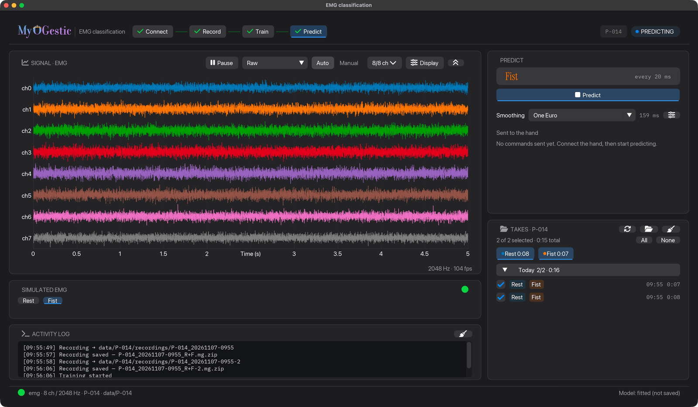

[`examples/synthetic/emg_classification.py`](https://github.com/NsquaredLab/MyoGestic/blob/main/examples/synthetic/emg_classification.py) classifies synthetic 8-channel EMG into two classes with CatBoost using RMS+MAV features from [`myogestic.recipes.features`][myogestic.recipes.features]. It can send LSL poses and gRPC movements to VHI.

!!! note "Code below is included from the example"
    The Python blocks are included verbatim from the runnable example, so they cannot drift
    from that script.

The app requires no user-defined classes beyond the framework's `App` and `Pipeline`.


## Run it first

One terminal, then launch EMG Generator and connect its stream in the Connect step.

```bash
uv run --extra examples python examples/synthetic/emg_classification.py
```

Recording, training and prediction work with or without VHI and the `grpc` extra. The Virtual Hand row shows Not running until you connect it. To drive the 3D hand, [install the Virtual Hand](../how-to/install-vhi.md), run with `uv run --extra examples --extra grpc python examples/synthetic/emg_classification.py`, and click Connect on its row. The app first checks for an existing service and launches the hand only if none answers.

## What you should see

{ loading=lazy }

The header carries Connect → Record → Train → Predict, the participant and session state. The signal and Simulated EMG controls stay visible beside the active step, with participant sessions and an activity log below. At narrow widths the same cards stack vertically.

Connect has the generator launcher, stream connection and optional Virtual Hand row. Hand movements… opens its full movement palette. Predict shows class probabilities, the output filter and Sent to the hand, with separate LSL `fist` and gRPC `gesture` values.

## The walkthrough

The script follows this order. Imports → outputs → constants → app setup → callbacks → layout → `app.run()`.

### 1. Outputs and side-channels

[`SimulatorControls`][myogestic.widgets.SimulatorControls] lazily publishes the generator's `EMG_Control` stream. Its persistent Rest and Fist chips preview either signal without changing a recording label. The Record step's class buttons also select the control-hand movement when a hand is connected; starting a take restores the signal for its selected label.

```python
--8 < --"examples/synthetic/emg_classification.py:poses"
```

The example declares two outputs in `examples/controls/classification_grpc.toml`. `fist` is a continuous activation, `0` for Rest and `1` for Fist, fanned out to the predicted hand's digits with negative thumb abduction for opposition. `gesture` is the matching movement name, sent to the control hand over gRPC after the configured `debounce_s = 0.1` settles a class change. The target's manifest supplies its controls and streams; nothing is resolved until the optional hand is connected, and gRPC clients are created only on that request.

### 2. The output filter

```python
--8 < --"examples/synthetic/emg_classification.py:filter"
```

[`PostProcessor`][myogestic.widgets.PostProcessor] is callable and has a UI panel. Pass it as `ControlBus(..., smoothing=output_filter)` to filter once per frame before any target sees the values. Render its panel inside `@app.ui`.

See [Post-process predictions](../how-to/post-process-output.md) for tuning.

### 3. Feature set

```python
--8 < --"examples/synthetic/emg_classification.py:features"
```

[`FeatureSelector`][myogestic.widgets.FeatureSelector] renders toggles for `rms`/`mav`/`wl`/`var`/`zc` from [`myogestic.recipes.features`][myogestic.recipes.features] and your own feature functions. Calling it, `features(window)`, runs every active feature over the channels-first window and concatenates the results along axis 0. These scalar-per-channel features produce one flat vector. `default=["RMS", "MAV"]` ticks two on at startup.

### 4. App, stream, pipeline

```python
--8 < --"examples/synthetic/emg_classification.py:setup"
```

The stream window is 0.2 s. Each `extract()` call sees the most-recent 0.2 s of EMG, channels-first as `(n_channels, n_samples)`. The buffer is 60 s so [`SignalViewer`][myogestic.widgets.SignalViewer] shows a longer history than the prediction window.

### 5. `extract` - same code for training and live predict

```python
--8 < --"examples/synthetic/emg_classification.py:extract"
```

`features(windows["emg"])` runs every active feature over the channels-first window, `(n_channels, n_samples)`, and returns one flat vector. Call the same function from `train()` for recorded windows and on the predict thread for live windows. Keep the selection fixed after training, or retrain after changing it.

### 6. `train` - slice sessions, featurize, fit

```python
--8 < --"examples/synthetic/emg_classification.py:train"
```

[`iter_labeled_windows`][myogestic.session.iter_labeled_windows] loads sessions and slices overlapping windows along the label track. Call `extract()` on each window. See [Record and replay](../how-to/record-and-replay.md).

The `is_empty` and `len(data.classes) < 2` checks validate the training selection and give
actionable errors. They follow the design principle "errors tell you what to write." If you forget to tick a session in [`SessionManager`][myogestic.widgets.SessionManager], you'll see "No sessions selected. Load some and tick the checkboxes." in the status panel.

### 7. `predict` - classify, smooth the pose and command movements

```python
--8 < --"examples/synthetic/emg_classification.py:predict"
```

The class index chooses both values from `CTRL_VALUES` and `CLASSES`. One bus frame carries `{"fist": 1.0, "gesture": "Fist"}` for a fist prediction. The bus smooths the continuous activation and debounces the discrete movement; LSL carries the predicted-hand pose and gRPC carries control-hand class changes. Palette clicks use `bus.select("gesture", state)` to send an immediate movement and rebase that trigger.

Without a connected bus, `predict` returns class and probabilities normally. `predict` never tries to bind. The Connect row runs capability discovery on a background worker because its RPC blocks. The returned `hand` dict, when present, supplies the values shown under Sent to the hand.

### 8. Layout

```python
--8 < --"examples/synthetic/emg_classification.py:layout"
```

A responsive [`Grid`][myogestic.Grid] keeps the header and status in bare rows. The wide layout places the live signal beside the active step and sessions; the narrow layout stacks them. Each active step is one card with one header. `SessionManager` returns a `TrainingData` instance; assigning it to `pipeline.training_data` connects the selected participant takes to `train()`.

### 9. The actual experiment loop

In the GUI:

1. In Connect, launch EMG Generator, then connect TestEMG1.
2. Optionally connect Virtual Hand; Hand movements… opens its palette.
3. Set a participant in the header and open Record.
4. Select Rest, record a take for about 3 s, then stop. Repeat with Fist and collect a few takes of each. A connected hand's recording gate disables its local keyboard during each take.
5. Select the participant's takes in the Takes panel, open Train, choose features and train.
6. Open Predict and start predicting. Use Simulated EMG to switch between Rest and Fist; the predicted class updates with or without the optional hand.
7. With a hand connected, inspect the smoothed `fist` and debounced `gesture` values under Sent to the hand.

Tune the One Euro sliders in the filter panel while predicting to adjust the lag/responsiveness trade-off in real time.

## Variations

- More classes: extend `CLASSES` and `CTRL_VALUES`, provide distinguishable generator patterns or real signals, and use movement names the hand advertises. The same prediction callback sends the selected activation and movement name.
- Different feature set: swap RMS/MAV for whatever your domain needs. Keep `extract()`'s return shape consistent across training and live.
- Different model: replace `catboost_classifier` with sklearn / XGBoost / PyTorch. See [Add a custom model](../how-to/add-a-model.md) for the patterns.
- Real hardware: replace `LSLSource("TestEMG1")` with a real source. See [Add a custom source](../how-to/add-a-source.md).
